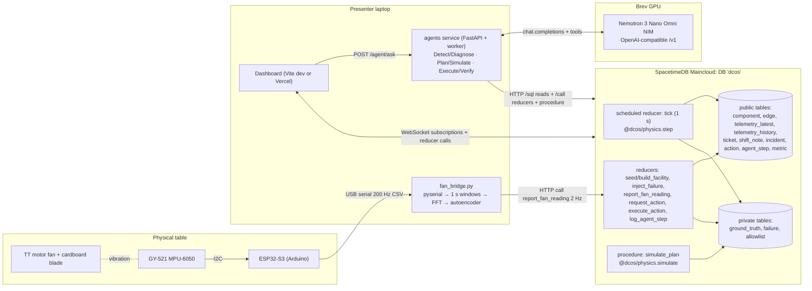

# DataCenterOS: PLAN.md

> **UPDATE, Sat 6 PM: the team plans in [`plans/`](plans/README.md) override this file.**
> - **Lanes, ownership, interfaces and scope:** [`plans/CONTRACTS.md`](plans/CONTRACTS.md) is authoritative wherever it differs from §3 (physics constants, the cooling model, new reducers and columns).
> - **Team:** 4 people, 5 lanes:
>   - S (Suvan): physics, eval and merges
>   - B: SpacetimeDB
>   - C: agents and NVIDIA/Brev
>   - D: frontend and pitch
>   - A: hardware, shared by the whole team
> - **Scope:** build **Tier 1 only** until it's tagged at 1:00 AM (see `plans/README.md`).
> - **Live fan fault:** a tape flap first, the coin second.

> **Build any data center. Break anything, including the real fan on our table. Watch AI keep it running.**

HackUTD 2026 "Zero Day". Plan written **Sat Nov 7, 4:20 PM**. Submission is due **Sun 12:00 PM**. Judging runs **Sun 1–4 PM**.

> **Scope warning:** the full vision in `HACKUTD/datacenteros.md` (any facility, many component types, cascading failures, 4+ agents) is too big for the ~19.5 hours left. This plan builds a **scoped-down version**:
> - 5 component types plus the real fan
> - 3 injected failure types
> - 3 agents
> - a form-based facility builder
> - a 50-scenario evaluation
>
> Everything else is in the backlog (§7) and the cut list (§9).

---

## 1. Overview

### 1.1 Pitch
- **One sentence:** "**Chaos engineering for real data centers**: build any facility, break anything (including a real fan), and AI agents find the root cause, test fixes in simulation, and stop operators from making it worse."
- **Short tagline:** "Build any data center. Break anything. Watch AI keep it running."

### 1.2 The person and the number
- **Person:** the on-call data-center operator at 3 a.m.
  - The shift handoff says *"Pump B repaired, ticket #41 closed."*
  - Pump B is actually still offline.
  - The operator's next task says *"Take Pump A down for scheduled maintenance."*
  - Doing it removes all cooling, and eight racks overheat in minutes.
- **Hard number (VERIFY before using):** Uptime Institute's annual outage analysis.
  - Power and cooling are the leading causes of significant data-center outages.
  - A majority of significant outages cost more than $100k.
  - A large share involve human or procedural error.
  - Use the exact figures from the 2025 or 2026 report on the slide.
- **NMC²'s own words** (quote these on stage): *"A missed warning, an unclear handoff, or the wrong information at the wrong time can turn a small issue into a major disruption."*

### 1.3 What other teams will build, and why this is different
| Typical NMC² / NVIDIA entry | DataCenterOS |
|---|---|
| A Grafana-style dashboard with LLM alert summaries | The agents **act**: they diagnose, test plans in a counterfactual simulation, block unsafe actions and execute fixes |
| A single fixed, scripted scenario | **The judge builds the facility and chooses the failure.** The same failure in a different facility leads to a different decision |
| The AI is told the answer (`root_cause: pump_failure`) | **Hidden ground truth.** Agents only see observable telemetry, tickets and notes, and must discover the cause (for example, a frozen sensor) |
| Everything simulated | **Real hardware in the loop:** a real fan, a real vibration sensor and a real trained anomaly model drive one rack |
| A "multi-agent planner" whose planning is invisible | Every agent step, tool call and simulated plan is a live row on screen |

### 1.4 Tracks targeted (3 sponsor tracks + general)
| Track | Brief, in its own words | How DataCenterOS satisfies it |
|---|---|---|
| **NMC² "Keep the World Running"** (1st AirPods Max Gen 2, 2nd Apple Watch Series 12, 3rd Echo Show 11) | "Help data center teams stay one step ahead": missed warning, unclear handoff, wrong information at the wrong time | **Missed warning:** the real fan's vibration fault is caught before temperature rises. **Unclear handoff:** a ticket says "repaired" while telemetry says offline, and the agent catches the contradiction and auto-writes a verified handoff. **Wrong information:** a frozen sensor is detected through heat-balance reasoning. **One step ahead:** recovery plans are simulated before they're executed |
| **NVIDIA "Use Nemotron Beyond a Chatbot"** (1st 2× RTX 5080 + $200 Brev, 2nd 1× RTX 5080 + $200 Brev + swag) | Beyond a chatbot, multi-step workflows, tool integration, real-world applicability | Nemotron 3 Nano Omni (self-hosted on Brev) runs 3 agents: detect + diagnose → plan + simulate → execute + verify. They use 12 tools, run counterfactual simulations and replan. Nobody chats with it; it acts on events |
| **Spacetime** (1st $2,048, 2nd $1,024, 3rd $512) | "Spacetime must power the app's primary functionality, not just chat or player movement." Public GitHub source is required | SpacetimeDB **is the backend**. It holds facility state, runs the physics tick (a scheduled reducer) and failure injection, and runs the safety engine inside `request_action`. Counterfactual planning is a SpacetimeDB **procedure** (`simulate_plan`). The hidden ground truth is a private table. Every screen is a live subscription |
| General: Best Hardware, Best Overall, Best Design | | The real fan rig plus a polished "command center" UI |

> **Track-limit check:** the event says you can enter up to two sponsor tracks. The team was told 3 are allowed. **Confirm with an organizer before Devpost registration (by 10:45 PM tonight).** If only 2 are allowed, enter **NMC² + Spacetime** (bigger and less crowded prizes) and drop NVIDIA.

### 1.5 Assumptions
1. **The team is 4 people**, mapped to the roles in `datacenter.txt`. Swap names in as you like:
   | ID | Role | Default owner |
   |---|---|---|
   | **A** | Data / hardware / CV: physics package, fan rig, fan ML | Teammate A |
   | **B** | Cloud / AI / ML: SpacetimeDB module, eval harness | Teammate B |
   | **C** | Deep AI / ML: Brev + Nemotron, the 3 agents, tools | Teammate C (Suvan or Karthik) |
   | **D** | Full-stack / AI: React dashboard, builder UI, pitch, Devpost | Teammate D |
2. **Hardware requested:** 1 ESP32-S3-DevKitC-1, 1 GY-521 (MPU-6050), 1 TT motor + wheel, 1 100 µF capacitor, 6 F-F jumpers, 1 USB-C cable, 1 Big Sounds module (backup), 1 hot glue gun. Bring cardboard and a coin.
3. **At least one laptop has an NVIDIA RTX GPU** (local fan model training, and a local fallback for Nemotron).
4. **Brev credits:** $40 × 4 = $160. One primary Brev account hosts the Nemotron NIM, and the others are backups.
5. **The facility is simulated** and the fan is real. We say so honestly on stage.
6. **No user auth.** Access is controlled by an identity allow-list inside SpacetimeDB (§2.3).
7. **Judging is at our table.** The laptop and the fan rig are physically present. Venue Wi-Fi may be flaky, so we have a phone hotspot as backup.

---

## 2. Full tech stack

### 2.1 Stack table
| Layer | Technology | Version | Why this choice | Alternative if it fails |
|---|---|---|---|---|
| Backend, state and simulation | **SpacetimeDB** TypeScript module on **Maincloud** | CLI/server 2.x (latest v2.14.1) | Required for the Spacetime track. Reducers, scheduled ticks, private tables and live subscriptions in one system | Run `spacetime start` locally on the laptop, with clients on the LAN |
| Physics engine | `@dcos/physics`: our own pure TypeScript package | TS 5.x | One deterministic implementation shared by the tick reducer, the `simulate_plan` procedure and the Node eval runner | If bundling a workspace package into the module fails, a `scripts/sync-physics.mjs` script copies the source into `spacetime/module/src/physics/` |
| Frontend framework | **React + Vite + TypeScript** | React 19, Vite 6 | Everything is client-side subscriptions, so it needs no server rendering. Simplest path to the SpacetimeDB React SDK | Next.js with `'use client'` pages |
| SpacetimeDB client | `spacetimedb` TypeScript SDK + React hooks (`SpacetimeDBProvider`, `useTable`, `useReducer`) | matching the CLI | Live table subscriptions | Poll the HTTP SQL endpoint every 1 s |
| Styling / UI | **Tailwind CSS** + **shadcn/ui** | Tailwind 4 | Fast, good-looking dark "command center" theme | Plain Tailwind |
| Graph view | **React Flow** (`@xyflow/react`) | 12.x | Facility topology: nodes and dependency edges with live status colors | A static SVG layout |
| Charts | **Recharts** | 2.x | Rack temperature, cooling margin, the fan's vibration spectrum | Chart.js |
| State management | SpacetimeDB subscriptions as the source of truth, plus React `useState` for UI-only state | | No Redux needed: the database *is* the state | |
| Agents runtime | **Python 3.12**, `openai` SDK (pointed at the NIM's OpenAI-compatible API), `httpx`, `pydantic` | | The team's ML speed. Tool calling via the OpenAI-compatible API | LangGraph only if needed (it adds complexity, so it's skipped by default) |
| LLM | **Nemotron 3 Nano Omni 30B-A3B Reasoning** NIM (`nvidia/Nemotron-3-Nano-Omni-30B-A3B-Reasoning`), self-hosted on **Brev** | | Required for the NVIDIA track. Tool calling plus JSON output. Self-hosting means no rate limit | (1) Hosted build.nvidia.com API, about 40 requests/min free. (2) A smaller Nemotron text model on the RTX laptop via llama.cpp |
| LLM cost | Brev GPU hours (L40S 48 GB or A100 80 GB; **VERIFY the price/hr on Brev**) | | Calls are free per request once the GPU is running. **Budget: at most $120 of the $160**, and stop the instance when idle | The hosted API at $0/call |
| Agent service | **FastAPI** + **uvicorn** (Python) | FastAPI 0.11x | Exposes `/agent/ask` and `/health` to the dashboard, and runs the background worker that watches incidents | A plain Python worker, with the dashboard only writing reducers |
| Fan sensing firmware | **Arduino IDE** + `esp32` board package + **Adafruit MPU6050** library | esp32 core 3.x | Streams vibration readings over USB serial | Big Sounds module on an analog pin (sound instead of vibration) |
| Fan bridge and ML | Python: `pyserial`, `numpy`, `scipy`, **PyTorch** (small autoencoder), `scikit-learn` (baseline) | | Real-time windowing, FFT features, anomaly score | An RMS threshold detector (no model) |
| Planning optimization | Deterministic candidate search inside `simulate_plan` | | Small action spaces: just try them all | OR-Tools is not needed |
| Evaluation | **Node 22** runner using `@dcos/physics`, plus Python `eval/run_eval.py` driving agents against the `dcos-eval` database | | Real runs, seeded, repeatable | Run fewer scenarios (20) |
| Hosting: frontend | **Vercel** (static Vite build) | | Public URL for the Devpost entry | Run locally on the laptop at the table |
| Hosting: backend | SpacetimeDB **Maincloud** (`dcos` prod DB; a local `dcos-eval` DB for eval) | | Free tier is about 2,500 TeV/month (~3M calls). 24 h of 1 Hz ticks is about 86k calls | Local `spacetime start` |
| Hosting: agents, fan bridge | The presenting laptop | | Needs USB serial (the fan) and low latency | |
| Auth | None for users. A SpacetimeDB **identity allow-list** table gates the admin reducers | | Demo speed. Anonymous callers can't inject failures or execute actions | |
| Package managers | **pnpm** workspaces (TS), **uv** (Python) | pnpm 9, uv 0.5+ | Fast installs, one monorepo | npm / pip |
| Lint / format | ESLint + Prettier (TS), Ruff (Python) | | Keep merges clean | Skip if behind schedule |
| Version control | Public GitHub repo `datacenteros`, trunk-based. Small `feat:` commits, a branch per lane (`lane/a-physics`, etc.), merge to `main` at sync points | | Spacetime requires public source | |
| Secrets | `.env.local` (gitignored) plus `.env.example` committed. Vercel env vars for the web app | | No secrets in git | |
| Hardware | ESP32-S3-DevKitC-1, GY-521 (MPU-6050), TT gear motor + wheel, 100 µF capacitor, F-F jumpers, USB-C cable, hot glue, cardboard, coin. Backup: Big Sounds | | A real rack fan in the loop | Laptop microphone listening to the fan (no extra parts) |

### 2.2 Accounts, keys and credentials (first 30 minutes)
| # | Credential / account | Owner | Where it goes | Done when |
|---|---|---|---|---|
| 1 | GitHub repo `datacenteros` (public) + invite all 4 | **D** | — | Everyone can push |
| 2 | SpacetimeDB account (`spacetime login`) + Maincloud DB names `dcos` and `dcos-dev` | **B** | — | `spacetime publish -s maincloud dcos-dev` succeeds |
| 3 | **Spacetime HACKUTD2026 credit** (ask at the Spacetime booth; it couldn't be verified online) | **B** | — | Credit shows in the account |
| 4 | Brev account ×4 (each teammate redeems their $40). The primary instance runs on **C**'s account | **C** (all redeem) | — | Credits visible |
| 5 | NGC API key (needed to pull NIM containers) | **C** | Brev instance env `NGC_API_KEY` | `docker login nvcr.io` works |
| 6 | build.nvidia.com API key (fallback LLM) | **C** | `.env.local`: `NVIDIA_API_KEY` | One curl call returns a completion |
| 7 | Agents' **non-owner** SpacetimeDB identity token (`POST /v1/identity`) | **C** | `.env.local`: `STDB_AGENT_TOKEN`. Its identity is added to `allowlist` with role `agent` | A reducer call with this token succeeds and a private-table SQL read **fails** |
| 8 | Presenter identity token (dashboard control panel) | **D** | `.env.local`: `VITE_STDB_PRESENTER_TOKEN` (demo only) | Inject failure works from the UI |
| 9 | Vercel project linked to the repo | **D** | Vercel env: `VITE_STDB_URI`, `VITE_STDB_DB` | Preview URL loads |
| 10 | Devpost team page (register **by 10:45 PM**) | **D** | — | All 4 members are on it |

`.env.example`:
```
# SpacetimeDB
STDB_HOST=https://maincloud.spacetimedb.com      # VERIFY the base URL at the booth or in the docs
STDB_DB=dcos
STDB_AGENT_TOKEN=
STDB_BRIDGE_TOKEN=
# LLM
NIM_BASE_URL=http://<brev-host>:8000/v1
NIM_MODEL=nvidia/Nemotron-3-Nano-Omni-30B-A3B-Reasoning
NVIDIA_API_KEY=                                   # fallback: https://integrate.api.nvidia.com/v1
LLM_MAX_TOKENS=512
LLM_MAX_STEPS=8
# Fan bridge
FAN_SERIAL_PORT=COM5
FAN_RACK_ID=rack_3
# Web (Vite)
VITE_STDB_URI=wss://maincloud.spacetimedb.com
VITE_STDB_DB=dcos
VITE_AGENT_URL=http://localhost:8787
VITE_STDB_PRESENTER_TOKEN=
```

### 2.3 Security minimums (demo-grade)
- **Allow-list:** every admin reducer (`seed_demo_facility`, `build_facility`, `inject_failure`, `execute_action`, `admin_*`) checks that `ctx.sender` is in the `allowlist` table with the right role, and throws otherwise.
- **The agents use a non-owner identity,** so the private `ground_truth` and `failure` tables are truly hidden from them. **Never give agents the CLI or publisher token.**
- **No secrets in the repo.** The presenter token exists only in the local `.env.local` of the demo laptop's build. The public Vercel build shows a read-only dashboard.
- **LLM caps:** `max_tokens` = 512, at most 8 tool steps per incident, at most 1 agent run per incident at a time, and a 10 s cooldown per incident.

---

## 3. Architecture

### 3.1 System diagram


**The data flow on one tick (every 1 s):**
1. `tick` loads the facility state, which includes the private true values, the active failures and the real fan's health.
2. It calls `physics.step(state, dt=1, rng)`.
3. It writes the true state to `ground_truth`.
4. It writes **observed** telemetry to `telemetry_latest` and `telemetry_history`. A frozen sensor keeps re-publishing its stale value.
5. It runs the deterministic monitors, which may insert `incident` rows.
6. The dashboards update through live subscriptions.
7. The agents' worker notices new incidents or pending actions and runs.

### 3.2 Repo structure (pnpm monorepo, public GitHub)
```
datacenteros/
├── PLAN.md                      # this file
├── README.md
├── .env.example
├── package.json                 # pnpm workspace root
├── pnpm-workspace.yaml          # apps/*, packages/*, spacetime/*
├── packages/
│   └── physics/                 # @dcos/physics (owner A)
│       ├── src/
│       │   ├── types.ts         # FacilityState, Component, Edge, Failure, Action, StepResult
│       │   ├── compile.ts       # compileTopology(config) → {components, edges, warnings}
│       │   ├── step.ts          # step(state, dtSec, rng) → state'  (pure, deterministic)
│       │   ├── simulate.ts      # simulate(state, actions, ticks, rng) → Outcome
│       │   ├── safety.ts        # checkAction(state, action) → {ok, reason, predicted}
│       │   ├── monitors.ts      # detect(stateObserved, history) → IncidentDraft[]
│       │   └── rng.ts           # seeded PRNG wrapper (mulberry32) for eval runner
│       └── test/*.test.ts       # vitest
├── spacetime/
│   └── module/                  # SpacetimeDB TS module (owner B)
│       ├── src/
│       │   ├── index.ts         # schema + reducers + procedure
│       │   ├── tables.ts
│       │   ├── reducers/
│       │   │   ├── seed.ts      # seed_demo_facility, build_facility
│       │   │   ├── tick.ts      # scheduled tick
│       │   │   ├── failures.ts  # inject_failure, clear_failure
│       │   │   ├── actions.ts   # request_action, execute_action
│       │   │   ├── fan.ts       # report_fan_reading
│       │   │   ├── agent.ts     # log_agent_step, update_incident, write_shift_note
│       │   │   └── admin.ts     # allowlist_add, admin_advance, reset_to_seed
│       │   └── procedures/simulate_plan.ts
│       └── package.json
├── apps/
│   └── web/                     # Vite + React dashboard (owner D)
│       ├── src/
│       │   ├── module_bindings/ # generated: spacetime generate --lang typescript
│       │   ├── stdb.tsx         # SpacetimeDBProvider setup
│       │   ├── pages/{CommandCenter,Builder,Results}.tsx
│       │   ├── components/
│       │   │   ├── FacilityGraph.tsx       # React Flow
│       │   │   ├── RackTelemetry.tsx       # Recharts
│       │   │   ├── CoolingMargin.tsx
│       │   │   ├── IncidentTimeline.tsx
│       │   │   ├── AgentSteps.tsx
│       │   │   ├── PlanCompare.tsx
│       │   │   ├── OperatorActions.tsx
│       │   │   ├── RealFanPanel.tsx
│       │   │   ├── PresenterControls.tsx   # hidden unless ?presenter=1
│       │   │   └── StatsBar.tsx            # events/s · subscribers
│       │   └── lib/format.ts
│       └── vite.config.ts
├── agents/                      # Python (owner C)
│   ├── pyproject.toml           # uv
│   ├── dcos_agents/
│   │   ├── stdb.py              # HTTP client: identity, sql(), call(), proc()
│   │   ├── llm.py               # OpenAI client → NIM; fallback switch
│   │   ├── tools.py             # 12 tool functions + JSON schemas
│   │   ├── prompts.py
│   │   ├── detect_diagnose.py
│   │   ├── plan_simulate.py
│   │   ├── execute_verify.py
│   │   ├── handoff.py
│   │   ├── worker.py            # polls incidents/actions, runs agents
│   │   └── api.py               # FastAPI: /health, /agent/ask
│   └── tests/test_tools.py
├── hardware/                    # owner A
│   ├── esp32_imu_stream/esp32_imu_stream.ino
│   └── bridge/
│       ├── fan_bridge.py        # serial → features → model → reducer
│       ├── features.py
│       ├── train_autoencoder.py
│       ├── record.py            # labeled recordings → data/*.npz
│       └── models/fan_ae.pt
├── eval/                        # owner B (+C)
│   ├── scenarios.ts             # seeded scenario generator (Node, uses @dcos/physics)
│   ├── run_eval.py              # runs none / rules / agent against dcos-eval DB
│   ├── rules_baseline.py
│   └── results/                 # csv + png committed
└── scripts/
    ├── demo_check.py            # asserts the demo path works end to end
    ├── sync-physics.mjs         # fallback copy of physics into the module
    └── gen-bindings.sh          # spacetime generate → apps/web/src/module_bindings
```

### 3.3 Data model (SpacetimeDB tables)
Types are SpacetimeDB column types. `u64` and `Timestamp` arrive as `bigint` in TypeScript. **Test the Python JSON round-trip in Phase 0.**

**Public tables** (clients and agents can subscribe or read):

| Table | Field | Type | Notes |
|---|---|---|---|
| `facility` | `id` | u32 PK | always 1 in v1 |
| | `name` | string | e.g., "DC-1 Demo Hall" |
| | `template` | string | `enterprise` / `ai_compute` / `edge` |
| | `seed` | u64 | for replay |
| | `tick` | u64 | current sim tick |
| | `sim_time_s` | f64 | |
| | `status` | string | `normal` / `degraded` / `critical` |
| `component` | `id` | string PK | `pump_A`, `rack_3`, `ups_1`, `util_1` |
| | `kind` | string | `utility` / `ups` / `pump` / `rack` / `sensor` |
| | `label` | string | display name |
| | `status` | string | **observed** status: `online` / `offline` / `degraded` / `shutdown` / `maintenance` |
| | `params_json` | string | kind-specific params, e.g. `{"capacity_kw":50}` |
| | `is_real_hardware` | bool | true for `rack_3` (the real fan) |
| | `x`, `y` | f64 | layout for React Flow |
| `edge` | `id` | u32 PK auto | |
| | `from_id`, `to_id` | string | |
| | `kind` | string | `power` / `cooling` / `sensing` |
| `telemetry_latest` | `component_id` | string PK | one row per component, updated every tick |
| | `tick` | u64 | |
| | `temp_c` | f64 | **observed** (a frozen sensor keeps the stale value) |
| | `power_kw` | f64 | |
| | `cooling_kw` | f64 | |
| | `load_kw` | f64 | |
| | `ups_energy_kwh` | f64 | UPS only |
| | `fan_health` | f64 | 0–1, real fan only |
| | `fan_anomaly` | f64 | 0–1 anomaly score, real fan only |
| | `sensor_age_s` | f64 | seconds since the reading last changed |
| `telemetry_history` | `id` | u64 PK auto | **ring buffer:** keep the last 120 per component, pruned in `tick` |
| | `component_id`, `tick`, `temp_c`, `power_kw`, `cooling_kw` | | |
| `ticket` | `id` | u32 PK | |
| | `component_id` | string | |
| | `title` | string | |
| | `status` | string | `open` / `completed` |
| | `notes` | string | e.g., "Replaced impeller, pump back online" (may be wrong) |
| | `created_tick` | u64 | |
| `shift_note` | `id` | u32 PK auto | |
| | `author` | string | `human` / `agent` / `system` |
| | `body` | string | |
| | `verified` | bool | agent-written notes are verified against live state |
| | `tick` | u64 | |
| `incident` | `id` | u32 PK auto | |
| | `opened_tick` | u64 | |
| | `symptom` | string | e.g., `cooling_margin_negative`, `thermal_imbalance`, `fan_vibration_anomaly` (a **symptom**, never a root cause) |
| | `component_ids` | string | CSV of related components |
| | `severity` | string | `low` / `high` / `critical` |
| | `status` | string | `new` / `investigating` / `planning` / `awaiting_approval` / `executing` / `resolved` / `failed` |
| | `hypothesis` | string | written by the agent |
| | `chosen_plan_json` | string | |
| | `resolved_tick` | u64 | 0 if open |
| `action` | `id` | u32 PK auto | |
| | `requested_by` | string | `operator` / `agent` |
| | `kind` | string | `shutdown_component` / `restore_component` / `shed_load` / `migrate_load` / `set_load` / `dispatch_tech` / `start_ups` |
| | `target_id` | string | |
| | `params_json` | string | e.g., `{"to":"rack_5","kw":4}` |
| | `status` | string | `pending` / `approved` / `blocked` / `executed` / `failed` |
| | `safety_reason` | string | from the safety engine |
| | `predicted_json` | string | `{"min_cooling_margin_kw":-38,"peak_temp_c":61,"racks_shutdown":8}` |
| | `incident_id` | u32 | 0 if none |
| | `tick` | u64 | |
| `agent_step` | `id` | u64 PK auto | **every agent thought or tool call is a row** (shown live) |
| | `incident_id` | u32 | |
| | `agent` | string | `diagnose` / `plan` / `execute` / `handoff` |
| | `step_no` | u32 | |
| | `kind` | string | `thought` / `tool_call` / `tool_result` / `decision` |
| | `tool` | string | |
| | `summary` | string | ≤ 280 chars, shown in the UI |
| | `payload_json` | string | truncated to 4 KB |
| | `tick` | u64 | |
| `metric` | `key` | string PK | `events_per_s`, `subscribers`, `agent_calls`, `downtime_rack_s`, `unsafe_blocked` |
| | `value` | f64 | |

**Private tables** (reducers and procedures only; agents **cannot** read them):

| Table | Field | Type | Notes |
|---|---|---|---|
| `ground_truth` | `component_id` | string PK | |
| | `true_status` | string | |
| | `true_temp_c` | f64 | |
| | `true_cooling_kw` | f64 | |
| | `thermal_mass_kj_per_c` | f64 | |
| `failure` | `id` | u32 PK auto | |
| | `kind` | string | `pump_fail` / `utility_loss` / `sensor_freeze` / `load_spike` / `ticket_lie` / `real_fan` |
| | `target_id` | string | |
| | `params_json` | string | |
| | `start_tick` | u64 | |
| | `active` | bool | |
| `allowlist` | `identity` | Identity PK | |
| | `role` | string | `admin` / `presenter` / `agent` / `bridge` |
| `tick_schedule` | `scheduled_id` | u64 PK auto | scheduled table, `ScheduleAt.interval(1_000_000n)` (1 s) |
| | `scheduled_at` | ScheduleAt | |
| `run_config` | `id` | u32 PK | `paused` (bool), `speed` (1 = real time), `seed` |

### 3.4 Physics model (`@dcos/physics`, deterministic)
All functions are **pure**. `rng` and `dtSec` are passed in, never `Math.random` or `Date.now`.
- **Heat load:** `Q_it = Σ load_kw(rack)` for racks that aren't shut down. (IT power becomes heat, 1:1.)
- **Available cooling:** `C = Σ capacity_kw(pump)` over pumps that are `online` and powered, times `fan_health` (for `rack_3`'s local share).
  - v1 simplification: cooling is one shared loop. Each rack gets `C × (load_i / Q_it)`, adjusted by its local fan health.
- **Rack temperature:** `T_i(t+dt) = T_i + dt × (load_i − cool_i) / thermal_mass_i`, with a passive pull toward `T_ambient = 22 °C` of `k = 0.02/s × (T_i − 22)`. Clamp to [18, 90].
- **Thresholds:**
  - `warning` at ≥ 35 °C
  - `degraded` at ≥ 45 °C (the rack's load drops 50%)
  - `shutdown` at ≥ 55 °C (load drops to 0, and the rack stays down until restored)
- **Power:** racks are powered if `utility_online` or the UPS has energy left. `E(t+dt) = max(0, E − P_draw × dt/3600)`. When it runs out, every rack on that feed shuts down. Pumps draw power too (pump draw = 5% of capacity).
- **Sensor freeze:** the true temperature evolves, but the observed `temp_c` stays at its value from when it froze, and `sensor_age_s` keeps increasing.
- **Real fan:** `fan_health = 1 − clamp((fan_anomaly − 0.3) / 0.6, 0, 1) × 0.7`, so a severe imbalance cuts that rack's local cooling by up to 70%.
- **Monitors** emit **symptoms only:**
  - `cooling_margin_negative` (C < Q_it)
  - `rack_temp_warning`
  - `thermal_imbalance`: a rack's reported temperature disagrees with the heat-balance prediction by more than 6 °C for 20 s, or its sensor age exceeds 15 s while neighbors change
  - `fan_vibration_anomaly`
  - `power_on_ups`
- **Default demo facility** (`seed_demo_facility`):
  - `util_1` (200 kW)
  - `ups_1` (20 kWh, 120 kW max)
  - `pump_A` and `pump_B` (50 kW each, one shared loop)
  - `rack_1` to `rack_8` at 6 kW each (48 kW IT load)
  - `rack_3` is the real fan
  - **This is deliberately N+0 for 48 kW** (one pump gives 50 kW, barely). Losing one pump is survivable, and losing both is catastrophic. That's the setup for the Pump A shutdown trap.

### 3.5 API contract
Three surfaces:
- **(A)** SpacetimeDB reducers and procedures: called by the web app over WebSocket, and by Python over HTTP.
- **(B)** SpacetimeDB HTTP, used from Python.
- **(C)** The agents FastAPI service.

Freeze it at the **7:00 PM sync**. Only additive changes after that.

#### (A) Reducers and procedures (`spacetime/module`)
| Name | Kind | Caller role | Args | Effect / returns |
|---|---|---|---|---|
| `seed_demo_facility` | reducer | admin, presenter | `()` | Wipes facility state and inserts the default facility, ticket #40 (real) and 1 human shift note. Schedules the tick |
| `build_facility` | reducer | admin, presenter | `(config_json: string)` | `compileTopology(config)`, then replaces the facility. Writes validation warnings into a `shift_note` (`author="system"`) |
| `tick` | scheduled reducer | system | `(arg: tick_schedule)` | Physics step, telemetry, monitors, ring-buffer pruning, metrics |
| `inject_failure` | reducer | admin, presenter | `(kind: string, target_id: string, params_json: string)` | Inserts a private `failure` row. A `ticket_lie` also creates a public ticket (#41) that falsely says "completed" |
| `clear_failure` | reducer | admin, presenter | `(failure_id: u32)` | Deactivates it |
| `report_fan_reading` | reducer | bridge | `(rack_id: string, anomaly: f64, fault_class: string, rms: f64)` | Updates `rack_3`'s fan anomaly and health |
| `request_action` | reducer | presenter, agent | `(kind: string, target_id: string, params_json: string, requested_by: string, incident_id: u32)` | Inserts an action and runs `safety.checkAction` on the **true** state (simulates 120 ticks). Sets `status` to `approved` or `blocked`, plus `safety_reason` and `predicted_json` |
| `execute_action` | reducer | agent, presenter | `(action_id: u32)` | Only if `approved`: applies it to the state, sets `executed`, logs it |
| `update_incident` | reducer | agent | `(incident_id: u32, status: string, hypothesis: string, chosen_plan_json: string)` | Agent progress |
| `log_agent_step` | reducer | agent | `(incident_id: u32, agent: string, step_no: u32, kind: string, tool: string, summary: string, payload_json: string)` | Inserts an `agent_step` row |
| `write_shift_note` | reducer | agent | `(body: string, verified: bool)` | Inserts a `shift_note` |
| `simulate_plan` | **procedure** | agent | `(actions_json: string, ticks: u32)` | Reads state, including the private true state **inside the module only**. Runs `physics.simulate` on a copy and **returns** a summary only: `{"min_cooling_margin_kw":..,"peak_temp_c":..,"racks_degraded":..,"racks_shutdown":..,"downtime_rack_s":..}`. It never returns the hidden root cause |
| `admin_advance` | reducer | admin | `(ticks: u32)` | Fast-forwards (eval only) |
| `set_run_config` | reducer | admin, presenter | `(paused: bool, speed: u32)` | Pause, speed up |
| `allowlist_add` | reducer | admin | `(identity_hex: string, role: string)` | |

**Example `build_facility` config:**
```json
{
  "name": "AI Hall B",
  "template": "ai_compute",
  "seed": 42,
  "components": {
    "utility": { "count": 1, "capacity_kw": 200 },
    "ups": { "count": 1, "energy_kwh": 20, "max_output_kw": 120 },
    "pump": { "count": 3, "capacity_kw": 30 },
    "rack": { "count": 8, "load_kw": 6, "real_fan_rack": 3 }
  },
  "redundancy": { "cooling": "N+1" }
}
```
**Example compiler warning** (written to `shift_note`):
`"Requested N+1 cooling: 3×30 kW = 90 kW, minus the largest pump = 60 kW ≥ 48 kW IT load ✔"`. Or for a failing design: `"N+1 NOT met: 2×30 kW minus 30 = 30 kW < 48 kW. Suggest pump capacity ≥ 48 kW."`

#### (B) SpacetimeDB HTTP (Python agents and bridge). Confirm the base URL at the booth
| Method | Path | Body | Response |
|---|---|---|---|
| POST | `/v1/identity` | — | `{"identity":"c200…","token":"eyJ…"}` |
| POST | `/v1/database/dcos/call/request_action` | `["shutdown_component","pump_A","{}","operator",0]` | `200` (empty) or an error text |
| POST | `/v1/database/dcos/call/simulate_plan` | `["[{\"kind\":\"shed_load\",\"target_id\":\"rack_7\",\"params_json\":\"{\\\"kw\\\":6}\"}]", 300]` | the procedure's return value (JSON) |
| POST | `/v1/database/dcos/sql` | `SELECT * FROM telemetry_latest` (text/plain) | `[{"schema":{…},"rows":[[…],…]}]` |

Header: `Authorization: Bearer $STDB_AGENT_TOKEN`.

`stdb.py` exposes:
- `sql(q) -> list[dict]`, which zips the schema column names with the rows
- `call(reducer, *args)`
- `proc(name, *args) -> Any`

#### (C) Agents service (FastAPI, `agents/dcos_agents/api.py`, port 8787)
| Method | Path | Request | Response |
|---|---|---|---|
| GET | `/health` | — | `{"ok":true,"llm":"brev-nim","model":"nvidia/Nemotron-3-Nano-Omni-30B-A3B-Reasoning","stdb":"ok"}` |
| POST | `/agent/ask` | `{"question":"Can I shut down Pump A for maintenance?"}` | `{"incident_id":12,"answer":"No. Pump B is offline even though ticket #41 says it was repaired. Shutting down Pump A drops cooling to 0 kW; simulation predicts 8 racks shut down within 6 min.","action_id":7,"action_status":"blocked","evidence":["telemetry_latest pump_B status=offline","ticket #41 status=completed","simulate_plan peak_temp_c=58.4"]}` |
| POST | `/agent/run/{incident_id}` | — | `{"started":true}` (manual retrigger) |

**Agent tools** (`tools.py`). JSON-schema function definitions are passed to Nemotron:
| Tool | Implementation | Returns (example) |
|---|---|---|
| `get_facility_topology()` | SQL `component` + `edge` | `{"components":[{"id":"pump_A","kind":"pump","status":"online"}],"edges":[…]}` |
| `get_component_status(id)` | SQL `component` + `telemetry_latest` where id | `{"id":"pump_B","status":"offline","cooling_kw":0}` |
| `get_recent_telemetry(id, n=30)` | SQL `telemetry_history` | `[{"tick":812,"temp_c":31.2},…]` |
| `get_component_dependencies(id)` | SQL `edge` (both directions) | `{"upstream":["util_1"],"downstream":["rack_1",…]}` |
| `get_maintenance_logs(id)` | SQL `ticket` | `[{"id":41,"status":"completed","notes":"Replaced impeller, pump back online"}]` |
| `get_shift_notes()` | SQL `shift_note` (last 10) | `[…]` |
| `get_active_incidents()` | SQL `incident` where status ≠ resolved | `[…]` |
| `simulate_recovery_plan(actions, ticks=300)` | procedure `simulate_plan` | `{"min_cooling_margin_kw":2.0,"peak_temp_c":38.1,"racks_shutdown":0,"downtime_rack_s":0}` |
| `validate_safety_constraints(action)` | reducer `request_action`, then read back `action.status` and `safety_reason` | `{"action_id":9,"status":"blocked","reason":"cooling 0 kW < load 48 kW"}` |
| `execute_simulated_action(action_id)` | reducer `execute_action` | `{"status":"executed"}` |
| `verify_service_recovery(component_ids, wait_s=20)` | Poll `telemetry_latest` and `incident` | `{"recovered":true,"max_temp_c":36.0}` |
| `write_handoff_note(body)` | reducer `write_shift_note(body, true)` | `{"ok":true}` |

#### (D) Fan bridge → SpacetimeDB
- **ESP32 serial line format** (USB CDC at 921600 baud, 200 Hz): `t_ms,ax,ay,az,gx,gy,gz\n`, e.g. `123456,0.012,-0.981,0.044,0.31,-0.12,0.05`
- **Bridge output, every 0.5 s:** `call("report_fan_reading","rack_3", 0.87, "imbalance", 0.142)`

### 3.6 Integration points and failure handling
| Integration | Failure mode | Handling |
|---|---|---|
| Brev NIM | Instance down, slow, or out of credit | `llm.py` falls back automatically on 2 consecutive errors or more than 20 s latency: Brev, then the hosted `integrate.api.nvidia.com`, then a local llama.cpp model. Show the current provider in `/health` and the UI |
| SpacetimeDB Maincloud | Network blip or venue Wi-Fi | The web client auto-reconnects. Agents retry with backoff (0.5, 1, 2 s). **Plan B:** `spacetime start` on the laptop, with `STDB_HOST=http://localhost:3000`, phones on the hotspot |
| Fan USB serial | Unplugged, or the port changed | The bridge auto-reconnects every 2 s. The UI shows "REAL FAN OFFLINE" and the rack falls back to simulated health 1.0 |
| ESP32 resets when the motor starts | Brown-out | 100 µF capacitor across 5V/GND. If it still resets, run the motor from a second USB port through a USB-A breakout, or a phone charger |
| `u64`/`bigint` JSON | Python receives numbers as strings or loses precision | Normalize in `stdb.py`, and test in Phase 0 (P0-C-02) |
| The LLM produces an invalid tool call | Bad JSON or an unknown tool | Validate with pydantic. On error, feed the error message back once, then stop and mark the incident `failed` with the reason (visible in the UI) |

---

## 4. MVP definition (done by **Sat 11:00 PM**)

### 4.1 MVP features (only these)
1. **Preset facility:** `seed_demo_facility` with util_1, ups_1, pump_A, pump_B and rack_1–8, where rack_3 is the real fan.
2. **Live 1 Hz physics tick** in SpacetimeDB: temperatures, cooling margin, rack degrade and shutdown.
3. **Failure injection:** `pump_fail` and `ticket_lie`, from the presenter controls.
4. **Safety engine** in `request_action`: blocks actions that lead to rack shutdowns within 120 s.
5. **Agent v1 (detect + diagnose + explain):** answers the operator's question by investigating with tools, catches the ticket-vs-telemetry contradiction, and logs every step.
6. **Real fan v1:** ESP32 + MPU-6050 stream, an **RMS-threshold** detector in the bridge, and `report_fan_reading` updating rack_3. The fault is visible on the dashboard.
7. **Dashboard v1:** React Flow facility graph with live colors, rack temperature charts, the incident timeline, live agent steps, operator action buttons and presenter controls.
8. **Deployed:** the module on Maincloud `dcos`, and the web app on Vercel.

### 4.2 "MVP done" checklist (all real, none mocked)
- [ ] `seed_demo_facility` from the presenter panel shows 12 nodes in React Flow within 2 s, and temperatures update every second.
- [ ] Clicking **Fail Pump B** turns pump_B red within 1 s, and the cooling margin drops to about +2 kW (50 − 48).
- [ ] **Ticket Lie** creates ticket #41 "Pump B repaired, completed" while pump_B still shows offline.
- [ ] Operator clicks **Request: Shut down Pump A**. The action shows `blocked` within 2 s, with `safety_reason` mentioning 0 kW cooling and predicted shutdowns.
- [ ] `POST /agent/ask {"question":"Can I shut down Pump A for maintenance?"}` returns, within 30 s:
  - an answer that names **ticket #41 contradicting pump_B's live status**
  - at least 4 tool calls visible as `agent_step` rows on the dashboard
- [ ] Taping the coin to the real fan pushes the rack_3 anomaly above 0.5 within 3 s, rack_3's fan health drops, and a `fan_vibration_anomaly` incident appears.
- [ ] The private tables can't be read with `STDB_AGENT_TOKEN` (a SQL query on `ground_truth` returns an error).
- [ ] The Vercel URL loads the read-only dashboard from a phone on cellular data.

### 4.3 Explicitly OUT of the MVP
The builder UI and compiler, the `simulate_plan` procedure and multi-plan planning, executing fixes automatically, frozen sensors, utility loss and the UPS, the autoencoder model, the eval harness, Challenge mode, auto-written handoffs and UI polish.

---

## 5. Phased build plan

| Phase | Time (Sat → Sun) | Goal | Exit criteria | Demoable at the end |
|---|---|---|---|---|
| **0: Setup** | **4:30 → 5:45 PM** | Hello world through every layer | The web app on Vercel shows a live row from the Maincloud module. Python calls a reducer with the agent token. Brev NIM answers a tool-call test. The ESP32 streams IMU data to the laptop | "Connected" dashboard, fan streaming numbers |
| **1: MVP core** | **5:45 → 11:00 PM** | The Pump A trap scenario end to end, plus the real-fan fault | The §4.2 checklist is all green. `git tag mvp` | **The core demo already works** |
| **2: The hard piece** | **11:00 PM → 3:00 AM** | Counterfactual planning + autonomous execution + hidden-truth diagnosis + the trained fan model + the **measured** eval | `simulate_plan` procedure, the planner chooses the best of 3 plans, execute + verify, frozen sensor diagnosed, autoencoder live, first 20-scenario eval CSV | Agents fix incidents themselves, with numbers on screen |
| **3: Expansion** | **3:00 → 7:30 AM** (sleep shifts) | Judge builds the facility. Challenge mode. Power/UPS. Handoff writer. Full 50-scenario eval | Builder → compiler → live facility. A second failure mid-response triggers a replan. The eval chart is committed | The full judge experience |
| **4: Polish + demo prep** | **7:30 → 10:30 AM** | It looks great and never breaks | Impeccable polish pass, demo seeded, 5 timed rehearsals, backup video recorded by 9:30, **feature freeze at 10:00 AM** | A final, rehearsed demo |
| **5: Submission** | **10:30 → 11:30 AM** (buffer to 12:00) | Devpost submitted | Video uploaded, repo public with README, all tracks selected | — |
| Judging | **Sun 1:00 → 4:00 PM** | Win | — | — |

### Phase 2: how the hard piece is measured (real runs only)
| Metric | Definition | How measured | Target |
|---|---|---|---|
| **Downtime avoided** | Rack-seconds degraded or shut down over 10 sim-minutes | `eval/run_eval.py`: 50 seeded scenarios × {no intervention, rules baseline, agents} on the `dcos-eval` DB | Agents < rules < none, reported as % reduction vs none |
| **Unsafe actions** | Executed actions that the true state shows caused shutdowns | The eval inserts 1 unsafe operator request per scenario | 0 executed by the agents; count blocked |
| **Root-cause accuracy** | The agent's `hypothesis` names the true failure (checked against the private `failure` table **by the eval harness only**) | String/enum match, judged by the harness, never by the agent | Report as X/50 |
| **Contradiction catch rate** | `ticket_lie` and `sensor_freeze` scenarios correctly flagged | Same | Report as X/Y |
| **Time to stabilize** | Ticks from the failure until all racks are under 35 °C and margin ≥ 0 | Same | Report the median |
| **Fan detection lead time** | Seconds between the vibration fault being detected and the rack_3 temperature-warning alarm the twin would raise from the same cooling drop | 20 coin/tape fault runs on the real rig, logged by the bridge | Report the median, plus false alarms/hour on a 30-min healthy run |
| **Agent cost** | LLM calls and tokens per incident | Logged in the `metric` table | Report the average |

---

## 6. Task breakdown with parallel workstreams

**Lanes:**
- **A** = Physics + Hardware + Fan ML
- **B** = SpacetimeDB module + Eval
- **C** = Agents + LLM infra
- **D** = Frontend + Design + Pitch

Times are Sat/Sun local.

### Phase 0: Setup (4:30–5:45 PM)
| ID | Description | Owner | Est | Depends | Definition of done |
|---|---|---|---|---|---|
| P0-ALL-01 | 15-minute kickoff: read §3.3–3.5 together, agree on table names and reducer signatures, assign lanes, decide on laptops (the demo laptop has the GPU and USB-C) | All | 15m | — | Contracts unchanged, or edited in this file and committed |
| P0-D-01 | Create the public GitHub repo `datacenteros`, pnpm workspace root, `.gitignore` (`.env*`, `node_modules`, `__pycache__`, `data/`), `.env.example` (§2.2), copy in PLAN.md | D | 20m | P0-ALL-01 | Everyone has cloned it |
| P0-B-01 | Install the `spacetime` CLI, `spacetime login`, then `spacetime dev --template basic-ts` into `spacetime/module`. Add a `facility` table + a `ping` reducer. Publish to `dcos-dev` on Maincloud. **Ask at the booth about HACKUTD2026 credit and the base URL** | B | 45m | P0-D-01 | `spacetime sql dcos-dev "SELECT * FROM facility"` works |
| P0-B-02 | `scripts/gen-bindings.sh`: `spacetime generate --lang typescript --out-dir apps/web/src/module_bindings --module-path spacetime/module` | B | 10m | P0-B-01 | Bindings committed |
| P0-D-02 | `pnpm create vite apps/web --template react-ts`, Tailwind 4 + shadcn init (dark), `stdb.tsx` with `SpacetimeDBProvider`. Show "Connected · facility rows: N". Deploy to Vercel with env vars | D | 50m | P0-B-02 | The Vercel URL shows a live row count |
| P0-C-01 | Brev: launch an L40S or A100 instance (**check the price/hr, budget $120**), pull and run the Nemotron 3 Nano Omni NIM (NGC key), open port 8000. `curl /v1/models`, then one chat completion with a `tools` definition | C | 60m | — | Returns a valid `tool_calls` JSON. **If not working by 6:00 PM, switch to the hosted API (§8)** |
| P0-C-02 | `agents/` with uv: `stdb.py` (identity, sql, call, proc), `llm.py`. Create the agent identity via `/v1/identity`, save the token, and have B allow-list it. Test (1) a reducer call, (2) a SQL read, (3) **a u64 round-trip**, (4) that a private-table read FAILS | C | 45m | P0-B-01 | All 4 checks printed by `python -m dcos_agents.selftest` |
| P0-A-01 | Pick up the hardware. Wire the GY-521: VCC→3V3, GND→GND, SDA→GPIO8, SCL→GPIO9. Flash `esp32_imu_stream.ino` (Adafruit MPU6050, ±4g, 200 Hz CSV over USB CDC at 921600) | A | 45m | — | `python hardware/bridge/record.py --print` shows about 200 lines/s |
| P0-A-02 | Fan rig: hot-glue the TT motor to a cardboard base and a cardboard blade to the wheel. Motor leads go to ESP32 5V/GND via F-F jumpers, with the 100 µF capacitor across 5V/GND (long leg to 5V). Hot-glue the IMU to the base, 3 cm from the motor | A | 30m | P0-A-01 | It spins for 5 min with no ESP32 resets |
| P0-A-03 | Scaffold `packages/physics`: `types.ts` (FacilityState, Component, Edge, Failure, Action, Outcome), a stub `step()`, and one vitest test | A | 20m | P0-D-01 | `pnpm -F @dcos/physics test` passes |

### Phase 1: MVP core (5:45–11:00 PM)
| ID | Description | Owner | Est | Depends | Definition of done |
|---|---|---|---|---|---|
| P1-A-01 | `step.ts`: heat load, shared cooling allocation, thermal update, thresholds (warning 35 / degraded 45 / shutdown 55), pump failure, fan-health factor, observed vs true state (stale for frozen sensors), sensor age | A | 2h | P0-A-03 | Tests: losing 1 pump keeps temp < 35 °C; losing 2 pumps shuts all racks down within 6 min sim; fan health 0.3 heats rack_3 only |
| P1-A-02 | `simulate.ts` (apply actions, run N ticks, return Outcome) and `safety.ts` (`checkAction` = simulate 120 ticks, block if any rack degrades or shuts down, or the margin < −1 kW) | A | 1h | P1-A-01 | Test: shutting down pump_A with pump_B failed is `ok=false` with a reason string |
| P1-A-03 | `monitors.ts`: the symptom detectors (§3.4) with hysteresis | A | 45m | P1-A-01 | Tests for each symptom |
| P1-B-01 | All tables from §3.3 in `tables.ts` (public/private as listed) + `allowlist` and its role check helper `requireRole(ctx, roles)`. **Schema freeze v1 at 7:00 PM** | B | 60m | P0-B-01 | Published to `dcos-dev`, bindings regenerated |
| P1-B-02 | `seed_demo_facility`: default facility (§3.4), ticket #40 (a real one), ticket #41 is created on `ticket_lie`, 1 human shift note "Night shift: Pump B work done, all good" | B | 45m | P1-B-01 | Calling it shows the rows |
| P1-B-03 | Scheduled `tick` (1 s) calling `physics.step` with `ctx.random`, writing `ground_truth`, `telemetry_latest`, `telemetry_history` (prune to 120 per component), running monitors → `incident`, updating `metric.events_per_s`. **Test the bundling of `@dcos/physics`; if it fails, use `scripts/sync-physics.mjs`** | B | 90m | P1-B-01, P1-A-01 | Telemetry updates every second, and history stays bounded |
| P1-B-04 | `inject_failure` / `clear_failure` (private table, `ticket_lie` creates a public ticket), `report_fan_reading`, `set_run_config` | B | 45m | P1-B-01 | The presenter can fail pump_B, and the bridge can update rack_3 |
| P1-B-05 | `request_action` (runs `safety.checkAction` on the true state), `execute_action` (approved only), `update_incident`, `log_agent_step`, `write_shift_note` | B | 75m | P1-B-03, P1-A-02 | The pump_A shutdown request ends up `blocked` with a reason |
| P1-B-06 | Publish to the **prod `dcos`** DB, set up the allow-list identities (presenter, agent, bridge), and tell D and C | B | 20m | P1-B-05 | All three tokens work |
| P1-C-01 | `tools.py`: the 9 read and validate tools for MVP (all except simulate, execute, verify), with JSON schemas, return shapes per §3.5, and 4 KB truncation | C | 90m | P0-C-02, P1-B-01 | `pytest agents/tests/test_tools.py` passes against `dcos-dev` |
| P1-C-02 | `detect_diagnose.py`: a tool-calling loop (max 8 steps, 512 tokens) that logs every thought and tool call through `log_agent_step`. System prompt: "You see only observable data. Never assume a ticket is accurate; verify against live telemetry. Report contradictions explicitly." | C | 2h | P1-C-01, P0-C-01 | For the Pump A question, it names ticket #41 vs pump_B offline in ≥ 4 steps |
| P1-C-03 | `api.py` (FastAPI `/health`, `/agent/ask`) + `worker.py` (polls `incident` status=`new` every 1 s, claims it, runs diagnose, sets `investigating`, then `awaiting_approval` or `resolved`) | C | 60m | P1-C-02 | `/agent/ask` returns the §3.5 response shape |
| P1-A-04 | `fan_bridge.py`: serial reader, 1 s windows (200 samples, 50% overlap), features (RMS per axis, FFT band energies 0–20/20–50/50–100 Hz), **RMS-threshold detector v1**, calls `report_fan_reading` at 2 Hz, auto-reconnects | A | 75m | P0-A-02, P1-B-04 | A coin on the blade gives anomaly > 0.5 within 3 s on the dashboard |
| P1-A-05 | `record.py`: labeled recordings for the ML. 10 healthy runs × 60 s, 10 coin runs, 5 tape-flap runs, 5 "pen touch" runs → `data/*.npz` | A | 45m | P1-A-04 | 30 labeled files |
| P1-D-01 | `FacilityGraph.tsx`: React Flow nodes from `component` (icons by kind, status colors), edges from `edge` (animated when flowing, red when broken). Real-fan node badge "REAL HARDWARE" | D | 2h | P0-D-02, P1-B-01 | Live colors change when pump_B fails |
| P1-D-02 | `RackTelemetry.tsx` (8 sparklines + selected-rack chart from `telemetry_history`) and `CoolingMargin.tsx` (a gauge: available cooling vs heat load) | D | 90m | P1-B-03 | Charts move every second |
| P1-D-03 | `IncidentTimeline.tsx` + `AgentSteps.tsx` (live `agent_step` rows grouped by incident; tool calls shown as chips) | D | 60m | P1-B-05 | Steps appear while the agent runs |
| P1-D-04 | `OperatorActions.tsx` (Request: shut down pump_A / restore pump_B / shed load; the "Ask the AI" input calls `/agent/ask`) + `PresenterControls.tsx` (`?presenter=1`: seed, fail pump, ticket lie, pause, speed ×1/×5) | D | 75m | P1-B-05, P1-C-03 | The full trap scenario can be clicked through |
| P1-D-05 | **Devpost registration** (project name, team, tracks: NMC², Spacetime, NVIDIA + Best Hardware/Overall/Design). **Ask an organizer about the track limit** | D | 15m | — | Registered **by 10:45 PM** |
| P1-ALL-01 | MVP integration run on prod: run the §4.2 checklist, fix blockers, `git tag mvp`, redeploy Vercel | All | 45m | All P1 | Checklist green |

### Phase 2: The hard piece (11:00 PM–3:00 AM)
| ID | Description | Owner | Est | Depends | Definition of done |
|---|---|---|---|---|---|
| P2-B-01 | `simulate_plan` **procedure**: parse the actions, copy the state (including the private true state, internally), `physics.simulate`, **return the summary only** (§3.5) | B | 90m | P1-A-02 | Called from Python, it returns JSON in < 500 ms |
| P2-A-01 | `sensor_freeze` + `load_spike` failures in physics (observed value stale, sensor age grows) + the `thermal_imbalance` monitor tuned so it fires within 30 s | A | 60m | P1-A-03 | Tests pass, and the symptom fires without revealing the cause |
| P2-C-01 | `plan_simulate.py`: given the diagnosis, generate 2–3 candidate plans (e.g., shed rack_7 + rack_8; migrate 6 kW to racks 1–2; dispatch a tech to restore pump_B), call `simulate_recovery_plan` for each, rank by (racks_shutdown, downtime, peak_temp), log a comparison table step, then `request_action` for the chosen plan | C | 2h | P2-B-01, P1-C-02 | Logs 3 simulated plans, picks the lowest-downtime safe plan |
| P2-C-02 | `execute_verify.py`: `execute_action` for approved steps, `verify_service_recovery` (poll 20 s). If not recovered, mark it failed and **replan once** | C | 75m | P2-C-01 | Incident goes `resolved` automatically on a pump_fail + load_spike scenario |
| P2-C-03 | Frozen-sensor diagnosis prompt: "If a sensor's age is high or its reading disagrees with the heat balance from load and cooling and its neighbors, suspect sensor failure; request a tech check; plan on predicted, not reported, temperature" | C | 45m | P2-A-01 | The `sensor_freeze` scenario hypothesis mentions the rack's sensor |
| P2-A-02 | `train_autoencoder.py`: a PyTorch MLP autoencoder (input: 18 FFT-band + RMS features, 16-8-16) trained on healthy windows only; threshold = 99th percentile of healthy reconstruction error; anomaly = sigmoid-scaled error; fault class via nearest-centroid on the labeled faults. Swap it into `fan_bridge.py` | A | 2h | P1-A-05 | On held-out runs: detection ≤ 3 s, false alarms reported |
| P2-A-03 | The lead-time experiment: 20 fault runs, log the detection time and the twin's rack_3 temp-warning time → `eval/results/fan_leadtime.csv` | A | 45m | P2-A-02 | CSV + median computed |
| P2-B-02 | `admin_advance`, `reset_to_seed`, publish to a local `dcos-eval` DB (`spacetime start`), plus `eval/scenarios.ts` (seeded generator: facility variant × failure kind × timing × 1 unsafe operator request) | B | 75m | P2-B-01 | 50 scenario JSONs written |
| P2-B-03 | `eval/run_eval.py`: for each scenario × {none, rules (`rules_baseline.py`: shed the hottest rack if margin < 0, never shut down pumps), agents}: reset, inject, advance with the agents responding (worker pointed at `dcos-eval`), collect metrics → CSV | B (+C) | 2h | P2-B-02, P2-C-02 | The first 20 scenarios run and the CSV is committed |
| P2-D-01 | `PlanCompare.tsx`: cards for each simulated plan (predicted downtime, peak temp, shutdowns), with the chosen one highlighted | D | 75m | P2-C-01 | It renders from `agent_step` payloads |
| P2-D-02 | `RealFanPanel.tsx`: live anomaly score gauge, RMS sparkline, fault class, "REAL HARDWARE" badge | D | 60m | P2-A-02 | It moves when the coin goes on |
| P2-D-03 | `StatsBar.tsx`: events/s, subscribers, agent calls, LLM provider | D | 30m | P1-B-03 | Visible on top |
| P2-ALL-01 | **3:00 AM sync:** run pump_fail + ticket_lie + sensor_freeze + real fan end to end on prod, `git tag hard-piece` | All | 30m | All P2 | All 4 work |

### Phase 3: Expansion (3:00–7:30 AM, with sleep shifts)
| ID | Description | Owner | Est | Depends | Priority | Definition of done |
|---|---|---|---|---|---|---|
| P3-A-01 | `compile.ts`: `compileTopology(config)` → components, edges, layout (x, y grid), and **validation warnings** (N+1 check, power capacity check) | A | 75m | — | **Must** | Tests: 2×30 kW with 48 kW fails N+1; 3×30 kW passes |
| P3-B-01 | `build_facility` reducer wrapping `compileTopology` (written *before* B's sleep, against A's interface) | B | 45m | P3-A-01 interface | **Must** | A config JSON creates a live facility |
| P3-D-01 | `Builder.tsx`: a form (template, counts, capacities, redundancy) → `build_facility`; shows compiler warnings; "Generate twin" → navigates to the Command Center | D | 90m | P3-B-01 | **Must** | A judge can build 3 pumps × 30 kW and see it live |
| P3-C-01 | **Challenge the AI:** the worker handles a second incident arriving mid-run by cancelling the current plan, logging "replanning: new failure detected", re-diagnosing, and re-simulating | C | 75m | P2-C-02 | **Must** | Fail pump_B, then a load spike mid-plan → it visibly replans |
| P3-C-02 | `handoff.py`: when an incident resolves, the agent writes a **verified** shift note (states only facts confirmed in telemetry, and flags the tickets it found false) | C | 45m | P2-C-02 | **Must** | A note appears with `verified=true` and "Ticket #41 is inaccurate" |
| P3-A-02 | `utility_loss` + UPS drain in physics; the `power_on_ups` monitor | A | 60m | P1-A-01 | **Should** | UPS energy drains on the chart; the agent sheds load to extend runtime |
| P3-B-02 | Run the full **50-scenario eval** + `eval/plot.py` (bar chart: downtime by strategy; table of unsafe actions, root-cause accuracy, contradictions caught, time to stabilize) → `eval/results/summary.png` | B | 90m | P2-B-03 | **Must** | Chart committed |
| P3-D-02 | `Results.tsx` page: embeds the eval chart + the fan lead-time results + an "honesty box" (the facility is simulated, the fan is real, n = 50, seeds) | D | 45m | P3-B-02 | **Should** | Page live |
| P3-A-03 | On-device inference: port the healthy-mean feature threshold (or a tiny model via TFLite Micro) to the ESP32, and send the anomaly over serial | A | 2h | P2-A-02 | **Could** | The ESP32 prints anomaly scores itself |
| P3-B-03 | The behavior-comparison demo: one button runs "same failure in a 2-pump vs 3-pump facility" and shows the two different agent decisions side by side | B + C | 60m | P3-B-01, P2-C-01 | **Should** | Two incidents with different chosen plans |

### Phase 4: Polish + demo prep (7:30–10:30 AM)
| ID | Description | Owner | Est | DoD |
|---|---|---|---|---|
| P4-D-01 | Run `/impeccable critique` on the Command Center, then fix the top 5 issues: hierarchy, readable type at 2 m distance, status colors with labels (not color alone), calm motion | D | 90m | Critique issues closed |
| P4-D-02 | Demo seed: `seed_demo_facility` + preset Builder configs ("Enterprise 2-pump", "AI Hall 3-pump"); the presenter panel's "Reset demo" in 1 click | D + B | 30m | Reset → ready state in < 5 s |
| P4-ALL-01 | **Rehearsal ×5,** timed against the §11 script. Each run, someone plays "judge" and breaks something unexpected | All | 60m | 3 clean runs in a row, each under 3:00 |
| P4-A-01 | Fan rig hardening: re-glue, label "REAL FAN · RACK 3", a spare coin + tape, check the cable strain relief | A | 20m | Survives 10 coin cycles |
| P4-C-01 | LLM hardening: confirm the Brev instance runs through 4 PM, check the fallback switch works (kill Brev, then the hosted API takes over within 20 s) | C | 30m | Fallback demoed |
| P4-D-03 | **Record the backup video by 9:30 AM:** the full 3-minute script on prod, screen + a phone camera on the fan (OBS) | D | 45m | `demo_backup.mp4` saved twice (laptop + cloud) |
| P4-ALL-02 | **Feature freeze at 10:00 AM.** Only fixes to the demo path after this | All | — | `git tag freeze` |

### Phase 5: Submission (10:30–11:30 AM)
| ID | Description | Owner | Est | DoD |
|---|---|---|---|---|
| P5-D-01 | Devpost write-up (§12 fields), screenshots ×4, GIF of the coin moment, architecture diagram (export the Mermaid) | D | 45m | Draft complete |
| P5-C-01 | README: one-liner, how to run (module, agents, bridge, web), tech list naming every sponsor tool, eval results, honesty notes | C | 30m | README merged |
| P5-B-01 | Repo cleanup: no secrets (`git log -p | grep -i token`), license (MIT), make sure it's public, pin versions | B | 20m | Clean |
| P5-ALL-01 | **Submit by 11:30 AM** (deadline 12:00) | D | 10m | Confirmation email received |

### 6.1 Timeline by lane
| Time | A: Physics/HW/Fan ML | B: SpacetimeDB/Eval | C: Agents/LLM | D: Frontend/Pitch |
|---|---|---|---|---|
| 4:30–5:45 PM | Pick up HW, IMU stream, fan rig, physics scaffold | CLI, login, module hello, bindings | Brev NIM up, `stdb.py` + selftest | Repo, Vite app, Vercel deploy |
| 5:45–7:00 | `step.ts` | Tables + allow-list (**schema freeze at 7:00**) | `tools.py` (read tools) | FacilityGraph |
| **7:00 SYNC** | Contracts frozen v1 · bindings regenerated · everyone pulls `main` | | | |
| 7:00–9:00 | `simulate.ts`, `safety.ts`, monitors | Seed + tick + failures | `detect_diagnose.py` | Telemetry charts, cooling gauge |
| **9:00 SYNC** | First live integration: tick → dashboard, fan → rack_3 | | | |
| 9:00–10:15 | `fan_bridge.py` v1 + recordings | `request_action` / `execute_action` / agent reducers, publish to prod | `api.py` + worker | Incidents, agent steps, operator and presenter panels |
| 10:15–11:00 | MVP checklist fixes | MVP checklist fixes | MVP checklist fixes | **Devpost registration (by 10:45)** + fixes |
| **11:00 PM SYNC** | **MVP tagged** · break 15 min, eat | | | |
| 11:15–1:30 AM | Sensor freeze + load spike → autoencoder training | `simulate_plan` procedure → eval DB + scenarios | Planner (3 plans) → executor/verify | PlanCompare → RealFanPanel |
| 1:30–4:30 AM | 😴 **Sleep** | `run_eval.py` (20 scenarios) → `build_facility` reducer (before 4:30) | Frozen-sensor prompt → Challenge mode → handoff writer | 😴 **Sleep** |
| **3:00 AM check-in (B + C)** | — | Tag `hard-piece` if the 4 scenarios pass | | — |
| 4:30–7:30 AM | Lead-time experiment → `compile.ts` → UPS physics | 😴 **Sleep** | 😴 **Sleep** | Builder page → Results page → StatsBar |
| **7:30 AM SYNC** | All back. Integrate builder + eval + handoff · full demo run | | | |
| 7:30–9:30 | (Could) on-device inference, fan hardening | Full 50-scenario eval + chart, demo seed | LLM hardening, 2-vs-3-pump comparison | Impeccable polish, **backup video by 9:30** |
| 9:30–10:00 | Rehearse ×5 (all) | | | |
| **10:00 AM FREEZE** | | | | |
| 10:00–11:30 | Fixes to the demo path only, practice the pitch | Repo cleanup | README | Devpost + **submit by 11:30** |
| 1:00–4:00 PM | **Judging:** A runs the fan, D presents, C answers agent questions, B answers Spacetime questions | | | |

### 6.2 Critical path
`P0-B-01 (module hello)` → `P1-B-01 (tables)` → `P1-A-01 (step)` → `P1-B-03 (tick)` → `P1-A-02 (safety)` → `P1-B-05 (request_action)` → `P1-C-02 (diagnose agent)` → **MVP (11 PM)** → `P2-B-01 (simulate_plan)` → `P2-C-01 (planner)` → `P2-C-02 (execute/verify)` → `P2-B-03 / P3-B-02 (eval)` → `P4-D-03 (backup video)` → submit.

**Anything on this chain that slips by more than 45 minutes triggers the matching fallback in §8.**

### 6.3 Sync points
| Time | Who | What must happen |
|---|---|---|
| 5:45 PM | All | Phase 0 exit check: Vercel → Maincloud → Python → NIM → ESP32, all green or a fallback chosen |
| 7:00 PM | All | Schema and reducer **freeze v1**, bindings regenerated, everyone rebased |
| 9:00 PM | All | First live integration: tick drives the dashboard, the fan drives rack_3 |
| 11:00 PM | All | MVP checklist (§4.2) and `git tag mvp` |
| 1:30 AM | All | Hand-off before sleep: each person writes 3 lines in `#status` (done / in progress / blocked) |
| 3:00 AM | B, C | Hard-piece check (4 scenarios) |
| 7:30 AM | All | Full integration + demo run |
| 10:00 AM | All | Feature freeze |

### 6.4 If you finish early, or get blocked
| Lane | Finished early → | Blocked → |
|---|---|---|
| A | Help D with fan visuals, start P3-A-03 (on-device inference), add Big Sounds as a second sensor channel | Blocked on B's tick: test physics in vitest + a Node runner against fixtures |
| B | Help C with tool correctness, start eval scenarios early, add `metric` counters | Bundling fails: use `sync-physics.mjs`. Maincloud down: switch to local `spacetime start` |
| C | Write `rules_baseline.py`, improve prompts with failed eval cases, add the "same failure, different facility" comparison | NIM not up: use the hosted API. Module not ready: build tools against a JSON fixture with the same shape |
| D | Builder page early, Results page, pitch slides, demo script | Bindings not ready: build components with mock props matching §3.3 types, wire them up later |

---

## 7. Feature expansion backlog (after the MVP)
| # | Feature | User value | Demo value | Effort | Risk | Owner | Status |
|---|---|---|---|---|---|---|---|
| 1 | Counterfactual planning (`simulate_plan` + 3 plans) | Fixes are tested before they're executed | ★★★★★ | 3.5h | Med | B + C | Phase 2 Must |
| 2 | Autonomous execute + verify + replan | Hands-free recovery | ★★★★★ | 1.5h | Med | C | Phase 2 Must |
| 3 | Frozen-sensor (hidden truth) diagnosis | Catches "wrong information" | ★★★★ | 1.5h | Med | A + C | Phase 2 Must |
| 4 | Fan autoencoder (trained) | Real ML on real hardware | ★★★★ | 2h | Low | A | Phase 2 Must |
| 5 | 50-scenario eval + chart | The measured number | ★★★★★ | 3.5h | Med | B | Phase 2–3 Must |
| 6 | Facility builder + compiler + N+1 validation | The judge designs the facility | ★★★★★ | 3.5h | Med | A + B + D | Phase 3 Must |
| 7 | Challenge the AI (second failure → replan) | Robustness | ★★★★ | 1.25h | Med | C | Phase 3 Must |
| 8 | Verified auto shift handoff | "Unclear handoff" solved | ★★★★ | 45m | Low | C | Phase 3 Must |
| 9 | Utility loss + UPS drain | Power scenarios | ★★★ | 1h | Low | A | Phase 3 Should |
| 10 | Same failure, different facility comparison | Proves it reasons | ★★★★ | 1h | Low | B + C | Phase 3 Should |
| 11 | Results page with honesty box | Credibility | ★★★ | 45m | Low | D | Phase 3 Should |
| 12 | On-device (ESP32) inference | Edge ML | ★★ | 2h | Med | A | Could |
| 13 | Big Sounds second sensor (sound + vibration fusion) | Robustness | ★★ | 1h | Low | A | Could |
| 14 | **Stretch:** generator with failed start, network switch, service reachability | Richer facilities | ★★ | 3h+ | High | A + B | Stretch |
| 15 | **Stretch:** drag-and-drop React Flow builder | Nicer building | ★★ | 2h | Med | D | Stretch |
| 16 | **Stretch:** Photon SMS to the on-call tech on critical incidents | Real-world action | ★★★ | 1h | Med | C | Stretch (it would be a 4th sponsor track, so check the limit) |
| 17 | **Stretch:** Redfish-shaped component fields | Industry realism | ★ | 1h | Low | B | Stretch |

---

## 8. Risks and fallbacks
| Risk | Early warning | Fallback | Decision deadline |
|---|---|---|---|
| Brev NIM won't deploy or is too slow | No `tool_calls` response by 6:00 PM, or latency > 10 s per call | Hosted `integrate.api.nvidia.com` (40 RPM is fine for event-driven agents), then local llama.cpp with a smaller Nemotron | **6:00 PM** |
| Brev credits run out | Spend > $90 by 8 AM | Stop the instance between rehearsals. Switch to the hosted API for judging | 8:00 AM |
| SpacetimeDB TS module can't bundle `@dcos/physics` | Publish errors on import | `scripts/sync-physics.mjs` copies the physics source into the module (one source of truth stays in `packages/physics`) | **7:30 PM** |
| Scheduled tick misbehaves | Ticks irregular or skipping | Increase the interval to 2 s, or have a Python "ticker" call a `tick_manual` reducer every 1 s (still a reducer, so still Spacetime-powered) | 8:30 PM |
| Maincloud unreachable or venue Wi-Fi bad | Reconnect loops | `spacetime start` locally on the demo laptop, everyone on the phone hotspot | Any time (practiced at 7:30 AM) |
| `bigint` JSON issues in Python | The selftest fails | Store ticks as `f64` mirrors in the public tables for Python reads | 6:00 PM |
| Agent quality poor (wrong diagnosis) | The Pump A scenario fails at 10:15 PM | Tighten the prompts, add a deterministic "contradiction detector" tool (`find_contradictions()`) the agent can call | 10:30 PM |
| Planner too slow (> 60 s per incident) | Timing logs | Cap at 2 plans, 120-tick simulations, and run the procedure calls in parallel | 1:00 AM |
| GY-521 pins unsoldered, or the IMU is dead | No I2C device found | **Big Sounds** analog on GPIO1 (sound features), or the laptop mic on the fan as a last resort | **6:30 PM** |
| ESP32 resets when the motor starts | Serial drops | Second capacitor (100 µF), slower motor start (blade off first), or motor on a separate USB power source | 7:00 PM |
| Autoencoder underperforms | > 2 false alarms in 10 min healthy | Keep RMS + band-energy thresholds (still real data); report honestly | 2:00 AM |
| Eval takes too long | < 20 scenarios done by 3 AM | Report 20 scenarios; make sure the chart shows n | 6:00 AM |
| Scope too big | Phase 2 not tagged by 3:30 AM | Cut items per §9, in order | 3:30 AM |
| A teammate is stuck for > 45 min | The 1:30 AM status shows the same blocker | Pair with a free lane or apply the fallback; the orchestrator (C) decides | Rolling |
| Judges can't see the fan well | Rehearsal feedback | Camera on the fan, shown in the corner of the dashboard; big "REAL FAN" label | 9:00 AM |

---

## 9. Cut list (cut in this order, no debate)
1. Stretch items 14–17.
2. On-device ESP32 inference (#12). The model stays on the laptop.
3. Big Sounds sensor fusion (#13).
4. Utility loss + UPS (#9). Pump failure + load spike + sensor freeze are enough.
5. The 2-vs-3-pump comparison button (#10). Explain it verbally using the builder instead.
6. The Results page (#11). Put the chart on one slide instead.
7. The free-form builder (#6). Replace it with **3 preset facilities** in a dropdown, keeping the compiler warnings.
8. Challenge mode (#7). Show a replan only in the recorded video.
9. Eval cut from 50 to 20 scenarios (never cut it entirely; the number is the hard piece).
10. **Never cut:** the Pump A trap scenario, the real fan → rack_3, live agent steps, `simulate_plan`, at least one measured number.

---

## 10. Testing and integration plan
- **Unit tests (only for tricky logic):** `packages/physics` vitest. Thermal update, thresholds, safety check, compiler N+1 validation, frozen-sensor observed-vs-true. Owner A. Run on every push (`pnpm test`).
- **Tool tests:** `agents/tests/test_tools.py` against `dcos-dev`: shapes, truncation, private-table access denied. Owner C.
- **`scripts/demo_check.py` (the demo path test).** Owner B. Run at **every sync** and after every deploy:
  1. `seed_demo_facility` → assert 12 components, telemetry updating
  2. inject `pump_fail pump_B` + `ticket_lie pump_B` → assert pump_B offline, ticket #41 completed
  3. `request_action shutdown_component pump_A` → assert `blocked` + a reason
  4. `/agent/ask` → assert the answer contains "41" and "pump_B" and that ≥ 4 agent steps exist
  5. (Phase 2+) inject `load_spike` → wait 60 s → assert the incident is resolved via an executed plan
  6. (Phase 2+) inject `sensor_freeze rack_5` → assert the hypothesis mentions the sensor
  7. Fan check is manual: the coin goes on → anomaly > 0.5 within 3 s
- **Who tests what:**
  - A tests the fan rig + physics.
  - B runs `demo_check.py` + the eval.
  - C tests the agent responses on 5 phrasings of the operator question.
  - D does a click-through on the deployed Vercel URL on a phone and on the demo laptop.
- **The demo path that must never break after the 10:00 AM freeze:**
  1. Reset demo
  2. Builder preset → generate
  3. Fail Pump B + ticket lie
  4. Operator asks "Can I shut down Pump A?" → blocked + explained
  5. Coin on the real fan → rack_3 anomaly → agents plan (3 simulated plans) → execute → recovered
  6. Show the handoff note
  7. Results chart
- **After the freeze:** only fixes that make `demo_check.py` pass. No new features.

---

## 11. Demo and pitch plan

### 11.1 Three-minute script
| Time | Beat | Who / what |
|---|---|---|
| 0:00–0:15 | **Pitch:** "Every data-center outage starts small: a fan, a stale sensor, a handoff that says 'fixed' when it isn't. DataCenterOS lets you build any data center, break anything, including that real fan, and AI agents keep it running." | D, pointing at the fan |
| 0:15–0:35 | **The person and the stakes:** "It's 3 a.m. The handoff says Pump B was repaired. It wasn't. The next task says take Pump A down for maintenance. That's zero cooling." Show the Uptime number (VERIFY) | D |
| 0:35–0:55 | **The judge builds:** hand the judge the Builder. Pick "2 pumps × 50 kW, 8 racks." The compiler warns "N+1 not met." Generate → the twin appears live | Judge + D |
| 0:55–1:25 | **Break it (the trap):** the judge clicks "Fail Pump B" + "Ticket lie." Then, as the operator, asks "Can I shut down Pump A?" Agent steps stream in: checks pump_A → dependencies → pump_B **offline** → ticket #41 says **completed** → contradiction → simulates → **BLOCKED**: "would shut down all 8 racks in about 6 min" | Judge + C narrates |
| 1:25–2:05 | **The filmable moment:** "Now break the real hardware." The judge tapes the coin to the fan. Within seconds: REAL FAN anomaly 0.9, rack_3 cooling drops, an incident opens. The agents **simulate 3 recovery plans** (cards appear), choose "migrate 3 kW from rack_3 to racks 1–2," execute, verify → rack_3 stabilizes. A verified handoff note is written: "Ticket #41 is inaccurate; pump_B offline" | Judge + A |
| 2:05–2:35 | **The number:** results slide: "Across 50 randomized facilities and failures: downtime cut X% vs no response and Y% vs rule-based; **0 unsafe actions executed**; root cause correct in Z/50; fan faults detected a median of N s before the temperature alarm." Honesty line: "The facility is simulated, the fan is real, and the agents never see the answer." | B |
| 2:35–2:50 | **Prize fit:** "For NMC²: missed warnings, unclear handoffs, wrong information. For NVIDIA: Nemotron agents planning, simulating and acting with 12 tools. For Spacetime: the entire facility, physics tick, safety engine and planning run inside SpacetimeDB, and every screen here is a live subscription" (point at the events/s counter) | C |
| 2:50–3:00 | **Close:** "Build any data center. Break anything. We'll keep it running. Want to break it again?" | D |

### 11.2 Pre-loaded demo data
- **Preset facilities:** "Enterprise DC-1 (2 pumps × 50 kW, 8 racks × 6 kW)" (the trap demo) and "AI Hall B (3 pumps × 30 kW)" (shows a different decision).
- Ticket #40 (real, closed) and the scripted ticket #41 lie, plus the human shift note.
- **Presenter token** in the demo laptop's `.env.local`. The `?presenter=1` controls stay hidden from the public URL.
- **Brev instance warm** from 12:30 PM Sunday, plus the hosted API key ready.
- **Fan rig:** spare coin + tape, cable taped down.
- **Phone hotspot** on, with the local `spacetime start` fallback tested at 7:30 AM.

### 11.3 Backup plan
- `demo_backup.mp4` (the full 3-min script, recorded at 9:00–9:30 AM), on the laptop + Google Drive + a phone.
- If the live LLM fails: the fallback switches to the hosted API automatically. If everything fails, play the video and still do the **live fan moment** (the bridge + dashboard work without the LLM).

### 11.4 Likely judge questions
| Question | Answer |
|---|---|
| "Isn't this all simulated?" | "The facility is a simulated testbed, which is how real chaos engineering works. But the fan is real hardware with a trained model, and the agents never see the ground truth: it sits in a private SpacetimeDB table their identity can't read." |
| "Did you script the agent's answer?" | "No. You picked the facility and the failure. The same failure in a 3-pump facility gives a different decision. Here are the raw tool calls." |
| "How do you know the agent is better?" | "50 seeded scenarios versus no response and a rule-based baseline: downtime X/Y/Z, 0 unsafe executions. The CSV and seeds are in the repo." |
| "Why SpacetimeDB?" | "The physics tick is a scheduled reducer, the safety engine runs inside `request_action`, counterfactual planning is a procedure, hidden truth is a private table, and every screen is a subscription. There's no separate backend." |
| "Why Nemotron, and what does it cost?" | "Self-hosted Nemotron 3 Nano Omni on Brev. It averages N calls and T tokens per incident, and is event-triggered, never per telemetry tick." |
| "Would a real operator trust this?" | "It never executes an unsafe action. Every block shows the simulated evidence, and the handoff note only states verified facts." |
| "What about real telemetry?" | "The tools are API-shaped (status, telemetry, dependencies). Next: Redfish and Prometheus adapters." |
| "What's next?" | "Redfish/DCIM adapters, more component types (generators, network), and learned failure predictors trained on the twin." |

---

## 12. Submission checklist
**Deadline: 12:00 PM Sunday. Target 11:30 AM.**

- [ ] **Devpost registration done by 10:45 PM Saturday** (team + tracks)
- [ ] **Tracks selected:** NMC², Spacetime, NVIDIA (confirm the limit), plus Best Hardware, Best Overall, Best Design
- [ ] **Title:** "DataCenterOS"
- [ ] **Tagline:** "Build any data center. Break anything. Watch AI keep it running."
- [ ] **Inspiration:** the 3 a.m. handoff story + the NMC² brief + the Uptime stat (VERIFY)
- [ ] **What it does:** the paragraph from `HACKUTD/datacenteros.md`
- [ ] **How we built it:** SpacetimeDB (TS module, scheduled tick, procedure, private tables), Nemotron 3 Nano Omni on Brev, Python agents, React + React Flow, ESP32-S3 + MPU-6050 + PyTorch autoencoder
- [ ] **Challenges:** honest ones (bundling physics into the module, hidden-truth design, fan motor resets, etc.)
- [ ] **Accomplishments:** the measured eval numbers + the fan lead time
- [ ] **What we learned / what's next**
- [ ] **Built with:** spacetimedb, nvidia-nemotron, nvidia-nim, brev, react, vite, react-flow, tailwind, shadcn, python, fastapi, pytorch, esp32, arduino, mpu6050, vercel
- [ ] **Links:**
  - [ ] Public GitHub repo (**required for Spacetime**)
  - [ ] Vercel URL
  - [ ] Demo video (YouTube unlisted; **check the Devpost length limit**, likely ≤ 3 min, VERIFY)
- [ ] **Media:** 4 screenshots (Command Center, agent steps + plan cards, real fan, results chart) + a fan GIF
- [ ] **README:** one-liner, architecture diagram, setup for each service, env vars (names only), eval results + how to reproduce, honesty notes, sponsor tools named
- [ ] **Repo hygiene:** no secrets (search the history), `.env.example` present, MIT license, `eval/results/` committed
- [ ] **NVIDIA:** README section "How Nemotron is used beyond a chatbot" (agents, tools, simulation, replanning)
- [ ] **Spacetime:** README section "What runs in SpacetimeDB" (tables, reducers, scheduled tick, procedure, private tables)
- [ ] **NMC²:** README section mapping to "missed warning / unclear handoff / wrong information"
- [ ] **Submitted 11:30 AM.** Confirmation screenshot saved
- [ ] **Before 1:00 PM judging:** Brev warm, demo reset, fan rig tested, hotspot on, video ready
