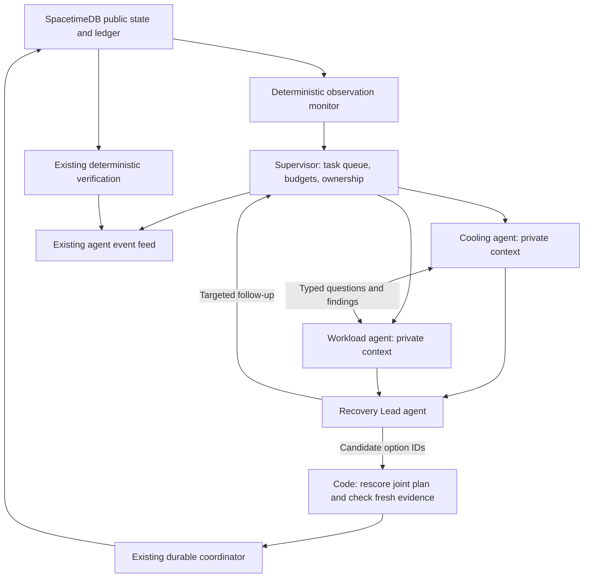

# Multi-agent fault recovery: a 5–6 hour implementation plan

**Prepared:** 2026-11-08. **Inspected source:** `d6d4275` and the current working tree. **Status:** proposed implementation, not completed work or fresh live acceptance.

**Confirmed constraints:** one primary implementer, others can help test; 5–6 hours; recovery covers simulated failed jobs/nodes and orchestrator restart; Brev remains observation-only. This sprint does not implement the separate real-workload proposal in `REAL-ENVIRONMENT-IMPLEMENTATION.md`.

## 0. Compressed build plan (current execution plan)

**Added 2026-11-08 06:20 CST. Where this section differs from §1–13, this section wins.** §1–13 remain the design rationale and safety rules. Times are estimates. Nothing here has been implemented or run yet.

**Who:** Kaushik and Claude subagents only. No other teammate is working on this sprint.

**Branch:** `Prod-Multi-Agent-System`, cut from `origin/int/r-sprint` at `ea5d99f`. **Do not merge `origin/r/multi-agent`**; Kaushik has dropped that approach. No changes to `apps/db`, contracts or generated bindings, so no database republish.

**Why compress:** the team schedule has the `main` merge and first rehearsal around 08:30, the backup video around 09:30, feature freeze at 10:00 and submission by 11:00–11:30. A 6-hour build would finish after submission.

### 0.1 What "talk" and "cover" mean here

**Agents talk.** Cooling and Workload each receive only part of the evidence, so each needs facts the other holds. Cooling sees pumps, loops, rack temperatures and headroom. Workload sees GPU and node health, jobs, checkpoints and placements. A question from one becomes real model input for the other, and the answer goes to the Recovery Lead. A displayed message that no model consumed does not count.

**Agents cover each other, at three levels:**

| Failure | Who covers | Result shown |
|---|---|---|
| Cooling or Workload times out, or returns an invalid or unsupported finding | The other specialist gets the failed role's evidence and answers for it, once, within budget | `Workload covering for Cooling`; if no budget remains, the Lead proceeds and the missing advice is shown |
| Recovery Lead fails | Existing deterministic choice over safety-checked options | `actor=code`; specialist findings stay in the trace |
| The agent process dies | Supervisor relaunches it; the new process reclaims the workflow after the 15 s lease expires and reconciles existing keys | Takeover in the feed; no duplicate checkpoint or placement |

The third row restarts the same agent; it is not a second agent taking over. A hot-standby second process is optional (WP-E) and off by default.

### 0.2 One team round

One round runs inside planning and replaces the single Nemotron choice. It runs once per plan attempt.

1. **Findings (parallel):** Cooling and Workload each make one forced `submit_finding` call on pre-packed evidence of about 6 KB. `question_for_peer` is required; a `null` question should carry a reason, and when none is given a code-authored placeholder is recorded instead of discarding the finding. Specialists have no tool loop and no access to the tool registry.
2. **Peer answers:** each question goes to the other specialist's own session, which makes one forced `answer_peer` call. Skip this phase when there are no questions.
3. **Cover:** at most one cover call, if a specialist failed and time remains.
4. **Decision:** the Lead receives findings, answers and the existing candidate board, then calls the existing `choose_options`. Choices go through the existing `decideJob`, conditional re-scoring and `resolveConflicts`.

**Budget:** at most 6 model calls per round. A corrective retry counts as one call (observed through `NimLlmEvent`). At most 2 requests in flight, 12 s per call, 30 s per round, and the Lead's 12 s is reserved (raised from 8, 25 and 9 s after live runs showed Workload exceeding 8 s). After the deadline, late replies are dropped using a `closed` flag on the round.

**Team LLM client:** build it with `createNimLlm({ ...cfg, LLM_TIMEOUT_MS: 12000 }, { maxRetries: 0, useFallback: false })` and apply the existing circuit breaker, set to open only after 3 consecutive failures. This replaces the cancellation plumbing in §5.

**Validation:** evidence IDs and resource IDs in a finding must exist in that round's bundle. An ID that does not is dropped and the finding is kept, with a code-authored supervisor note recording how many were dropped. But when the bundle had evidence and **nothing** grounded survives, the whole reply is refused: the summary is kept verbatim, so a claim whose entire basis was invented would otherwise ship invented numbers without their IDs, against the honesty rules in `WORKFLOW-TAB-INTEGRATION.md`. The invented IDs are model text and are never repeated into the trace. Findings are claims and never become GPU or job facts, and the Lead still chooses only from code-validated options.

**Persistence:** the round is awaited inside planning, so there is one writer and §4's serialized queue is not needed. Store a bounded trace (24 messages at most, 400 characters per summary) as `workflow.state.team` in the existing patches at `agent-loop.ts:342` and `:487`. Emit feed events after that write, as `Cooling → Workload: ...` with `actor=nemotron`, and tool calls named `team_message`. A crash mid-round reruns the round; it has no live write tools.

**Triage in team mode:** runs deterministically (`llm: null`), so triage does not add model calls.

**After the round:** model latency widens the window for stale choices, and the replan watcher only starts after planning. Immediately after a team plan, compare it with a fresh snapshot using the existing `materialChange` logic. If anything material changed, enter the normal replan path.

### 0.3 Frozen interface

Subagents code against this; only the main session changes it.

```ts
// planner.ts: export Choice and buildLlmPayload
export interface ChooserInput {
  ix: SnapshotIndex;
  incidents: Incident[];
  evidence: Evidence | null;
  ranked: ReadonlyMap<string, RankedOption[]>;
  toolCalls: ToolCallSummary[];
  workflowId: string;
  attempt: number;
}
export interface ChooserResult { choices: Choice[] | null; team: TeamTrace }
export type OptionChooser = (input: ChooserInput) => Promise<ChooserResult>;
// PlannerDeps.chooser?: OptionChooser    PlanResult.team?: TeamTrace
// planner.ts:850 uses chooser when present, else askNemotron. choices === null follows the existing LLM-outage path.
// PlannerDeps.waitForCapacity?: boolean  PlanResult.waiting_jobs?: { job_id: string; reason: string }[]
```

`DCOS_AGENT_TEAM_MODE=single|multi`, default `single`, so the rehearsal path is unchanged until the gates pass.

### 0.4 Work packages and file ownership

| WP | Scope | Files owned |
|---|---|---|
| **A: team round** | §0.2, role prompts, evidence partitioning, cover, budget; fake-LLM tests | `apps/agent/src/team/*`, `apps/agent/test/team/*`; the seam lines in `planner.ts` |
| **B1: wiring and new-fault detection** | Flag, team client, chooser through `plan()` and `runReplan`, post-round freshness check, new-incident watch | `config.ts`, `main.ts`, `agent-loop.ts`, `replan.ts` and their tests |
| **B2: waiting recovery** (starts after B1) | §0.6 | `agent-loop.ts`, `waiting_jobs` logic in `planner.ts`, tests |
| **C: harness and supervisor** | `--team-mode`, team assertions, `nodeCrash` injector, Scene B case, supervisor | `apps/agent/scripts/**`, `apps/agent/test/live/*` |
| **D: integration** (main session) | Apply diffs, NIM smoke, live runs, Codex review, evidence | Everything at merge points |
| **E: hot standby** (optional, off by default) | §0.7 | `agent-loop.ts`, after B2 |

**Worktree rules:** A, B and C run in separate worktrees. Subagents do not commit, push or touch `.env*` or tokens. The main session applies their diffs to the main checkout, and Kaushik makes each commit.

**New-incident watch (B1):** while a workflow executes, run the existing `precheck` every 2 s, with one read in flight. An unhandled candidate raises a flag combined with `w.shouldAbort()` at `agent-loop.ts:443`. The existing replan then folds the incident in and plans jointly. Check the flag again before `verify`. Trigger once per distinct candidate fingerprint, and ignore symptoms caused by the plan's own actions, so it cannot burn the replan limit. This replaces §6's monitor and provisional investigation during execution.

**Supervisor (C):** a small script relaunches the agent on abnormal exit, passes through SIGINT and SIGTERM, runs one child at a time, and stops after a bounded number of restarts.

### 0.5 Gates and cut order

Assumes a 06:30 start.

| Target | Gate | If it fails |
|---|---|---|
| 06:40 | **G0:** physics build, agent tests and typecheck pass on the new branch | Stop and fix the baseline |
| 07:40 | **G1:** real NIM smoke: distinct contexts, at least one consumed peer answer, measured latency within budget, useful findings | Stay in `single` and report why |
| 08:15 | **G2 (Scene A):** L3 in team mode passes live, with no duplicates and both incidents separate | Debug until 08:30, then leave `multi` off for rehearsal |
| 08:45 | **G3 (Scene B):** nodes return, checkpoint-backed jobs restart, progress is verified, including a SIGKILL during the wait | Drop Scene B; G2 still ships |
| 09:15 | **G4:** L1–L6 regression as time allows, Codex review findings fixed, evidence saved | Freeze scope and disclose gaps |

**Cut order:** WP-E, then Scene B, then the new-incident watch's pre-verify check, then cover calls. **Never cut:** command-key dedupe, fencing, stale-round rejection, deterministic fallback labels, observed verification, or the `single` mode path.

### 0.6 Waiting recovery, simplified (B2)

Replaces §7's `recovery.ts` and per-job disposition machinery.

- With `waitForCapacity` set, the planner reports `waiting_jobs` for failed jobs that have a complete, accessible checkpoint but no eligible `migrate_restart`. It forces those jobs to zero commands, so a model cannot choose `escalate` for them. If every affected job is waiting, skip the team round: zero model calls.
- Inside `driveWorkflow`, persist `state.recovery` with stage `plan`, then poll every 2 s. Compare a fingerprint of node and GPU availability and checkpoint-store access. On a change, plan again as a new attempt.
- At most 3 attempts. The deadline is 120 wall seconds, measured from a persisted `first_wait_unix_ms`, so it survives restarts. At expiry, hand off through `escalate`.
- Restart: stage `plan` already returns through `took_over` and `continueTakeover` into `driveWorkflow`. Prove this with a SIGKILL during the wait.
- A failed job with no completed checkpoint is excluded from automatic restart and reported for an operator. A paused simulator shows as paused. Storage-outage waiting is out of scope.

### 0.7 Optional hot standby (WP-E)

Build only if G3 passes early and Kaushik says yes. A second process with `AGENT_STANDBY=1` does not claim new incidents; each tick it adopts open workflows whose leases have expired, through the existing `takeovers` `resume` path. **Limit:** `request_action` and `claim_action` do not check workflow ownership (§8), so a stalled but living primary could still issue requests. Reservations and key dedupe bound the damage, but this is safe to claim only for a process that is actually dead. Closing the gap needs a database contract change, which is out of scope.

### 0.8 Acceptance and disclosure

**Automated (fake LLM):** the §11 cases that remain in scope, plus: evidence partitioning differs by role; a peer answer appears in the recipient's next input; the Lead's input contains findings; cover triggers once and stays in budget; a late reply after the deadline has no effect; an all-waiting plan makes zero model calls; the new-incident watch fires once per fingerprint. Run `pnpm --filter @dcos/physics build`, `pnpm --filter agent test` and `pnpm --filter agent typecheck`.

**Live:** Scene A and Scene B from §11. Use a local database for iteration, then one final run on `dcos-dev`, announced to the team first. Save the live report plus team trace. Fake-LLM tests are not evidence of live multi-agent recovery.

**Demo must state:**
- Findings inform choices, but deterministic safety decides what can run.
- A running action cannot be interrupted, and two recovery actions never run at once.
- The agent process restarts automatically; a separate machine failure is not covered.
- Better recovery scores for the team are unmeasured unless a single-versus-multi comparison is run.
- Triage grouping is deterministic in team mode, so a live run's handoff can read "LLM unavailable" while the team rounds were Nemotron. Both are true; say it before a judge asks.

**Docs:** once G2 passes, update `plans/FEATURES.md`, which still lists zones, agent messages and automatic takeover from the dropped branch, along with its "cover for each other" one-liner. Align the Devpost text. The web Agent room is outside this sprint; if it ships, its live roles must be Cooling, Workload and Lead.

### 0.9 Progress

**Updated 2026-11-08 10:15 CST.** Live means real Nemotron against the disposable local database `dcos-r-local`, except where a row names `dcos-dev`. L3 in team mode has now run three times on `dcos-dev`: the first failed one check, and the two after it passed 18/18. The third (v4) is the current evidence and the only one taken on the citation-fixed code (see G4). Nothing has run on prod.

| Gate | Status | Evidence |
|---|---|---|
| **G0** baseline | Passed 06:26 at `1dd61b4` | Physics build and typecheck clean; 404 agent tests pass |
| **G1** real NIM | Passed about 06:57 | L1 in team mode, 12/12 checks with a real SIGKILL. One round: 5 model calls, 11 s, Lead decided, both peer answers consumed |
| **G2** Scene A | Passed 07:03; committed and pushed as `468cda2` | L3 in team mode at speed 1, 18/18 checks: destination Xid, SIGKILL, DB-finished checkpoint, reclaim, separate incidents, new destination, verified handoff. Two rounds, Lead decided both, 5 calls at most |
| **G3** Scene B | **Recovery passed; conversation check passed in 1 of 2 runs** | SBK 25/25: all nodes crash, jobs wait, SIGKILL during the wait, fresh process keeps the original wait start, jobs restart from checkpoints, job-c goes to an operator, agents talked. SB 20/21: the same recovery, but Workload timed out at 12 s, so Cooling covered and no peer answer was possible |
| **G4** regression and review | **Review done and fixed; `dcos-dev` L3 passes on the fixed code, but only on a dirty tree** | Codex review raised 9 issues: 6 confirmed and fixed in `c5ee1f3`, merged as `bb25f19`; 3 deferred (see Open). 573 agent tests pass and typecheck is clean. `dcos-dev`, L3 in team mode, three times, all on `nvidia/nemotron-3.5-lightning-30b-a3b` (`live_nim`): **FAIL 17/18** at `dd61041-dirty` (`L3-team-v2-dev/`), **PASS 18/18** at 15:46 at `2ca6153-dirty` (`L3-team-v3-peerfix/`, two consumed answers in one round, one cover), and **PASS 18/18** at 15:59 in 205 s at `1a4c94f-dirty` (`L3-team-v4-grounded/`, the current evidence). v4 is the only run on the citation-fixed code and is strictly the strongest: **four consumed answers across both rounds** (`a1:e1:m7`, `a1:e1:m8`, `a2:e3:m5`, `a2:e3:m6`), **no cover occurred**, Lead decided 2/2, max 5 calls of the 6 budget. Every run so far is on a dirty tree, so none is a reproducible citation. Not done: an L3 run on a committed HEAD; L2 and L4–L6 in team mode; no L1 or SBK rerun on the fixed code |

| Work package | Status |
|---|---|
| A: team round | Done, in `468cda2` |
| B1: wiring and new-incident watch | Done, in `468cda2`. The watch runs in `multi` only |
| C: harness and supervisor | Done, in `468cda2`. The supervisor passed with a stand-in child; it has not yet run the real agent |
| B2: waiting recovery | Done and proven live on the local database. 573 agent tests pass, typecheck clean |
| D: integration | In progress |
| E: hot standby | Not started; off by default |

**Codex review: 6 confirmed issues fixed in `c5ee1f3` (merged as `bb25f19`):**
- **High.** After a crash, a job already restarting could still be listed as waiting, so the wait ran on until it escalated. Restarting jobs are now filtered off the waiting list.
- **High.** If capacity returned during a team round, the wait compared against a snapshot that already showed it back, so it never saw a change. It now compares against `planning_snapshot`.
- **Medium.** The wait did not wake when a finishing job freed healthy GPUs. A rise in `free_gpus` now wakes it.
- **Medium.** A job held in the first planning pass was never reconsidered after the Lead's choice freed what it needed. It is now re-ranked.
- **Medium.** A resolved incident on a resource hid a new fault on that same resource from the new-incident watch. Resolved incidents no longer count as handled.
- **Low.** Findings were marked consumed by the Lead even when the circuit breaker blocked the Lead's call.

A regression test disproved part of one review finding: the only live rack was too hot, so the job could not have been placed there anyway.

**The `dcos-dev` L3 failure (17/18), in detail:**
- The one failed check is `team: specialist answer consumed by a role`: 0 specialist answers, so none reached a role's model input.
- **Recovery itself was verified**: the checkpoint completed while the agent was dead, a fresh process reclaimed the workflow, the checkpoint completed exactly once with no double allocation, the new destination excluded the dead GPU, and the handoff was persisted. The Lead decided both rounds inside budget (max 4 calls).
- The cause was Workload's finding being rejected in **both** rounds, for **two different reasons**: round 0 `invalid arguments (no_question_reason)`, round 1 `1 unknown evidence id(s), 1 unknown resource id(s)`. Cooling covered each time. Because the peer-answer phase requires the responder to hold a valid finding, Cooling's question went unanswered in both rounds.
- **Both causes are fixed and both are now live-proven.** The 15:46 rerun (v3) proved the `no_question_reason` fix: 18/18, Workload accepted in both rounds, two answers consumed, but one cover still occurred. The 15:59 rerun (v4), the first on the citation-fixed code, went further: four consumed answers across both rounds and **no cover at all**, so neither specialist failed in either round. The drop-and-keep path is what removed the cover, and the uncited refusal did not cost it. Neither fix is committed yet, so the evidence is behavioural, not citable.

**Found by live runs and fixed:**
- Specialists declined to ask questions when the prompt allowed it, so no talking happened in the first run. The question is now required.
- Workload could not say which racks jobs run on, so it could not answer Cooling. `current_rack_ids` was added, with a regression test.
- On macOS the harness's SIGKILL hit only the `tsx` wrapper, so the agent survived and the first L1 run failed. Multi-mode cases, Scene B and the supervisor now launch the agent directly. Single-mode L1–L6 still use the old launch.
- One slow specialist tripped the shared circuit breaker for 60 s, which could stop the Lead from being called. The team's breaker now opens after 3 consecutive failures.
- Nemotron put real rack names in `evidence_ids`, so valid findings were rejected. These IDs are now moved to `resource_ids`.
- A null `question_for_peer` with no stated reason discarded the whole finding, which cost the peer conversation in round 0 of the `dcos-dev` run. A missing reason now records a code-authored placeholder and the finding is kept. **Fixed in the working tree, not yet committed or re-verified live.**
- An invented citation ID discarded the whole reply, which cost the peer conversation in round 1 of the same run. A partly ungrounded reply now has the bad IDs dropped and is kept, with a supervisor note recording the counts; a reply with nothing grounded left is still refused, by Kaushik's call, so an entirely invented basis cannot reach the Lead. **Fixed in the working tree and live-proven by the v4 `dcos-dev` run (18/18, no cover needed), but not yet committed.**

**Open:**
- **Workload latency varies widely.** The same 8,972-byte prompt took 5.8 s in SBK and over 12 s in SB. When it times out, covering works, but that round has no peer conversation. Do not promise a conversation in every round.
- **Findings can be factually wrong.** In SBK, Workload said job-a occupied rack-r6, and in an earlier run a cover claimed checkpoint-backed jobs had no checkpoint support. The Lead still chose only from code-validated options, and safety does not depend on findings, but the text shown to judges may contain errors.
- **A live run's handoff reads as a contradiction.** Both `dcos-dev` reports label the run `live_nim` with Nemotron, yet both hypotheses say "deterministic grouping (LLM unavailable)". This is by design, not a fault: `agent-loop.ts:1077` passes `llm: chooser ? null : llm`, so team mode deliberately gives triage no model (§0.2, so triage adds no model calls), and `triage.ts:900` then labels the grouping "no LLM configured". Both statements are true — the grouping was code, the team rounds were Nemotron — but side by side on a surface judges can read they look contradictory. Pre-existing, in the v2 and v3 reports alike.
- **Rejections are hard to diagnose.** They now name the invalid field for argument errors, but a citation rejection records only counts, never the offending IDs, since those are model text. The `dcos-dev` unknown-ID case therefore cannot be diagnosed from the saved evidence; dropping such IDs instead of the whole reply makes it non-fatal, not visible.
- **Deferred (review).** A restart can bypass the 120 s wait deadline. Real but narrow, and postponed because the fix touches the takeover logic L1 and L3 depend on.
- **Deferred (review).** A round could make a 7th model call, one over budget. Not observed live: v4 reported `max 5 calls across 2 round(s)`, and no run so far has exceeded the budget. That is evidence the path is rare, not that it is closed.
- **Deferred (review).** A round could have 3 requests in flight, one over the limit. Like the 7th call, it needs a corrective retry plus a second failure in the same round, and the result is a slightly over-budget round, not an unsafe action.
- Each live result is a single run. All but the L3 `dcos-dev` run are on the local database.
- **Not one live run in this sprint is reproducible from a commit.** Every report in `live-results/agent-team-2026-11-08/` records a `-dirty` commit: L1 and L3-scene-a at `1dd61b4-dirty`, SB and SBK at `468cda2-dirty`, and the three `dcos-dev` runs at `dd61041-dirty`, `2ca6153-dirty` and `1a4c94f-dirty`. So every gate row above, G1 through G4, rests on a tree that no longer exists. The runs are real and their checks are real, but none can be re-derived from the repository. An L3 run on a committed HEAD is the one piece of outstanding evidence and the only version worth citing publicly; the cheapest way to fix the rest is to rerun whichever gates matter after the commit.
- **`nemotron_ok` and `nemotron_failed` in every report are dead counters.** `asserts.ts:633` tallies them by scraping agent stdout for `nemotron ok` / `nemotron failed`, and nothing in `apps/agent/src` or `packages/` ever prints either string, so both read 0 in every report ever produced, passing runs included. Do not cite `nemotron_ok=0` as evidence of anything. The real model evidence is the event attribution (`nemotron=17` on v4) and `team lead=2 fallback=0`.
- L1 and SBK have not been rerun on the fixed code.
- Better recovery scores for the team are unmeasured.

**Evidence:** `apps/agent/live-results/agent-team-2026-11-08/`.

## 1. Recommendation and finish line

Build **three distinct model agents inside the existing Node process**, with separate prompts, conversation state, tool permissions and typed message inboxes:

1. **Cooling specialist:** identifies shared cooling causes and evaluates thermal constraints.
2. **Workload recovery specialist:** identifies GPU/node failures, checkpoint availability and recoverable jobs.
3. **Recovery lead:** requests specialist work, consumes their findings and chooses a coordinated recovery from code-generated candidates.

A deterministic supervisor routes messages, budgets calls and persists progress. The existing coordinator remains the only component that submits execution commands. Cooling and Workload investigate concurrently; the lead can send a targeted follow-up before choosing. Use the existing NIM client/model for all three. Separate models, machines or OS processes are unnecessary for independent agent contexts and communication.

The finish line is a saved live run showing actual specialist calls, a useful message exchange, two distinct incidents, a corrected plan after a destination failure, and successful orchestrator restart without duplicate checkpoint/placement. A second short run shows failed jobs restarting after simulated nodes become available again.

**Scope limit:** diagnosis and communication run concurrently; this sprint retains one active execution coordinator per run. It does not promise simultaneous execution of unrelated recovery commands. An already-running checkpoint/restart can delay the next physical intervention. Make that wait visible.

**Why this can help:** specialists can investigate cooling and compute evidence independently, challenge a questionable destination and explain a joint choice. The existing deterministic planner already handles numerical scoring and resource conflicts; adding model agents should not duplicate that work. Better recovery scores are a hypothesis to measure, not an automatic consequence of adding agents.

## 2. What the code already provides, and where to intervene

| Existing source | Finding | Sprint change |
|---|---|---|
| `apps/agent/src/agent-loop.ts` | `tick()` awaits the entire workflow; `runOnce()` rejects overlapping ticks. New triage normally waits behind execution | Add a small observation monitor that stays active during execution and queues new evidence |
| `triage.ts` | Deterministic extraction/grouping, then one model assessment; `runTriage()` also persists incidents/symptoms | Retain extraction/grouping and central persistence; specialists receive observed evidence without live write tools |
| `planner.ts` | Enumerates candidates, scores jobs in priority order, re-scores after changed choices, resolves placement conflicts and scores the combined plan | Add an injectable choice provider; the Recovery Lead replaces the existing single choice call in team mode |
| `replan.ts` | Watches active-plan resources, cancels only unstarted actions, reruns triage/planning | Include pending new incidents and shared cooling/storage changes; use the same team choice hook on replans |
| `resume.ts` | Reclaims workflow ownership, reconciles existing keys, checks a persisted plan against fresh state | Reuse this; add resumption of incomplete analysis and waiting recovery work |
| `coordinator.ts` | Persists exact command payloads and owns workflow heartbeat; `updateStage()` is not a serialized write queue | Serialize coordinator state updates before adding asynchronous specialist completions |
| `verify.ts` | Checks observed effects and progress; persists unresolved infrastructure/handoff | Keep deterministic verification; include team findings as attributed context, never as proof of recovery |
| `tools/registry.ts` | Provides useful tools, but includes `propose_plan`, which writes a plan despite the registry's “read-only” comment | Give specialists an explicit allowlist that excludes all persistence/action tools |
| `snapshot-db.ts` | Useful isolated observed snapshot adapter; its action status method always returns null | Reuse snapshot isolation; supply captured real ledger statuses for team reads rather than treating this stub as live truth |
| `packages/physics/src/gpu/actions.ts` | Failed jobs can already `migrate_restart`; finite node crashes can end; jobs do not restart themselves | Add recovery wake-up logic above the physics layer |
| `planner.ts` / `agent-loop.ts` | Failed jobs enter planning when incidents are handled; handled/closed incidents can suppress later recovery opportunities | Persist waiting work and revisit it when actual capacity/storage improves |

Current source is ahead of several older planning documents. R1/R2/R3 and a real/cached Nemotron fixed12 artifact already exist. Do not rebuild those foundations. The saved fixed12 batch records 76 live responses, 51 cache hits and 3 fallback decisions; it does not evaluate this proposed agent team.

## 3. Runtime design



Logical peer messages travel through the supervisor so their identity, scope, budget and persistence are controlled. This is actual communication: the recipient gets the message in its next model input, and the resulting answer is consumed by another agent. Merely printing three role names on a sequential call is insufficient.

| Agent | Task and tools | Structured result |
|---|---|---|
| Cooling | Read observed cooling/dependency evidence; inspect the affected GPUs; read existing candidate forecasts; ask Workload about placements/checkpoints | Suspected common cause, supporting evidence, risky resources, uncertainties, answer to a peer question |
| Workload | Read GPU/node signals, job state, completed checkpoints, captured action status and candidate placements; ask Cooling about a destination | Independent failure assessment, job/checkpoint facts, unavailable resources, recovery prerequisites |
| Recovery Lead | Consume both findings, inspect the scored candidate board, request at most one extra investigation, choose option IDs | Per-job choices, explanation, referenced findings and unresolved objections |

The supervisor assigns initial tasks using deterministic symptom families. Agents may request one bounded follow-up task for an existing peer; the supervisor validates it and admits it only within the round budget. This gives adaptive delegation without a fourth model call merely to route every event.

Tools return an immutable round snapshot. A model cannot change the tool's snapshot ID, impersonate another role, inject faults, directly publish a plan, or execute an action. Agent findings are claims linked to observations; they never become authoritative GPU/job facts by being repeated.

Use the existing placement/scoring functions once per candidate board. Specialists may ask to inspect a candidate by ID. Do not give every specialist unlimited `simulate_plan` loops: simulations are synchronous CPU work in this Node process and can delay heartbeats. Retain the existing candidate bounds and yield between job batches if measurements show event-loop stalls.

## 4. Communication and persistence contract

Put the new protocol in **one agent-local module**, for example `apps/agent/src/team/protocol.ts`, with Zod validation and inferred types. This is versioned workflow application state, not a replacement for canonical `ActionCommand`, `Incident` or other wire types. Import those existing types. The dashboard initially consumes existing event summaries, so no new DB tables, reducer arguments, generated bindings or public actor enums are needed.

Illustrative message envelope:

```ts
type TeamMessage = {
  id: string;
  workflow_id: string;
  round_id: string;
  task_id: string;
  task_attempt: number;
  from: 'supervisor' | 'cooling' | 'workload' | 'lead';
  to: 'supervisor' | 'cooling' | 'workload' | 'lead';
  kind: 'task' | 'question' | 'finding' | 'objection' | 'decision';
  reply_to: string | null;
  incident_ids: string[];
  evidence_ids: string[];
  resource_ids: string[];
  summary: string;
};
```

The runtime supplies envelope identity/routing fields; models supply only validated content and an allowed destination. Bound summaries to 400 characters and ID arrays to 12 items. Findings can carry a small validated payload such as candidate IDs and an uncertainty category. Do not store raw reasoning or unlimited chat transcripts.

Persist `workflow.state.team` with:

- `version: 1`, round ID, snapshot fingerprint, snapshot sim time, phase and remaining budget.
- At most 8 tasks: role, objective, status, attempt, deadline and accepted result.
- At most 24 recent messages, plus the accepted findings/decision retained separately from that ring buffer.
- Pending observed changes and any waiting recovery record.
- Actual model ID, request/response/fallback counts and elapsed wall time.

Task statuses: `pending → running → completed | failed | superseded`. Persist a task assignment before calling the model. Persist a validated reply before another agent consumes it. Model work interrupted before reply persistence may be repeated; action execution remains protected by the ledger.

All team state writes go through the current coordinator's serialized update queue. Merge against the latest cached state **inside** the queue. Add a state-only patch method that preserves the current workflow stage; a late diagnostic reply must not move an executing workflow back to `plan`. Existing execute/verify updates use the same queue. Heartbeats retain their existing no-version-bump behavior.

Use separate identifiers for separate concerns:

| Identifier | Purpose |
|---|---|
| `message.id` / task attempt | Deduplicate delivery of an accepted team reply; same ID with changed content is invalid |
| `round_id` + captured ownership generation | Reject late replies from superseded analysis or a prior workflow owner |
| Snapshot fingerprint | Decide whether a finding/candidate still describes current relevant state |
| Existing `command_key` + payload hash | Deduplicate the logical action across retries |
| Existing workflow/action fencing tokens | Reject stale protected ownership operations |

A rerun of interrupted model work gets a new task attempt/message identity; do not require a stochastic model to reproduce identical text under an old message ID. Keep fencing tokens inside runtime code, out of prompts and public summaries.

## 5. Decision flow and bounded agent interaction

1. Extract/group observed symptoms using existing deterministic code. Preserve separate cooling and compute incidents unless evidence supports a common cause. Sharing `power-main` or occurring at the same time alone is insufficient evidence to merge incidents.
2. Claim the workflow; capture one observed snapshot/evidence bundle and relevant ledger statuses. Build the existing candidate board from that snapshot. Exclude real Brev metrics from simulated diagnosis.
3. Assign Cooling and Workload tasks as applicable. Start their independent sessions concurrently, with an overall limit of two in-flight model requests.
4. Deliver validated questions/findings through the mailbox. Each specialist may use a bounded tool/follow-up turn. Unknown evidence IDs or unsupported resource claims are rejected, not passed to the lead as fact.
5. The Lead receives the findings and the scored candidate board. It may request one specific follow-up if it would affect a choice; otherwise it calls the existing validated `choose_options` shape.
6. Preserve the planner's sequential conditional scoring, conflict resolution and whole-plan simulation. When the Lead changes a higher-priority job's choice, re-score later jobs as the code already does. Do not sum whole-cluster option scores.
7. Refresh relevant evidence after model latency. Supersede stale choices and replan; never “fix” an accepted command's payload under its existing key.
8. Execute through request → claim → start → DB-owned completion, then observed verification and handoff.

**Expected useful exchange, illustrative only:**

> Cooling → Workload: “Pump A explains warming on r2–r4. Does job-a have a completed checkpoint?”
>
> Workload → Cooling: “Its checkpoint is writing; destination GPU on r1 now reports Xid79. Preserve the source write and exclude that destination.”
>
> Lead → Cooling: “Check the remaining candidate's loop headroom after job-a moves.”
>
> Lead → Coordinator: “Choose the newly validated destination; reuse the completed checkpoint.”

Generate all displayed messages from actual calls/tools; the example is not a script to inject into the UI.

### Default budgets, to validate in the first smoke test

- Three agent roles; two concurrent requests maximum; one active planning round.
- At most **6 actual model HTTP attempts per round**, including retries, corrective calls and endpoint fallback. Reserve capacity for the Lead; deterministic fallback is allowed.
- About 6 KB evidence per specialist, a bounded candidate board for the Lead, and 768 output tokens per call initially.
- 8-second per-attempt timeout and 25-second total round deadline. These are initial engineering caps, not measured endpoint performance.
- One peer follow-up phase; no recursive agent creation or debate-until-consensus.
- Keep the existing bounded replan count; a non-actionable gauge change does not consume it.

`LlmPort` currently exposes no caller cancellation signal, and `llm.ts` can retry/correct/fallback internally. Add an optional signal/deadline and an attempt-budget hook at the actual HTTP-attempt boundary. Cancellation must stop the endpoint loop, not start a fallback request. A `Promise.race` timeout alone leaves requests running and is insufficient. Count a timed-out request as an attempt even if it eventually answers.

If calls fail or the round budget expires, use the existing deterministic choice path with fresh safety checks and explicit `actor=code`. Missing specialist advice is visible. No model response means no claim that the agents agreed.

## 6. Simultaneous faults and new faults during execution

Implement a read-only monitor driven by `onChange`, plus a 1-second poll while a workflow is active. Coalesce bursts for roughly 250 ms and allow only one snapshot read at a time. It emits compact change notices into a bounded supervisor queue; it does not concurrently run `runTriage()` against the live DB.

Monitor these material inputs:

- GPU/node availability and new Xids, including candidate destinations.
- Cooling state and observed capacity for both the source and candidate destination loops.
- Checkpoint completion/accessibility and job lifecycle changes.
- Newly observed incident candidates outside the active plan's current resource set.
- Capacity returning that can satisfy persisted recovery work.

Ignore ordinary temperature jitter, progress increments and unrelated version changes. Include a relevant thermal-band/freshness change when it affects feasibility. Deduplicate notices using resource/event identity and a material fingerprint, not wall timestamps alone. Reconstruct pending work from current state after restart; the in-memory queue is a wake-up mechanism, not the only source of truth.

**One active recovery episode per run:** multiple incidents keep separate IDs and hypotheses, but share one execution workflow and a joint resource view. Fresh incidents during recovery join this episode. Avoid concurrent `driveWorkflow()` calls and independent specialists racing to reserve the same job/GPU.

During a running action, the monitor can trigger new specialist investigation. Those results remain provisional until the coordinator can integrate them at a safe boundary. Before the next unstarted action, and again before final verification/closing, drain pending notices and run the refreshed joint planner. The second check matters when the new fault arrived during the last command.

| Overlap | Required behavior |
|---|---|
| Pump degradation + independent GPU Xid | Keep separate incidents; both specialists work; plan all affected jobs together |
| Destination Xid during source checkpoint | Keep the valid source checkpoint running; cancel/supersede only the unstarted destination move; choose another placement after fresh evidence |
| Source Xid during checkpoint | Accept physics failure; do not manufacture a completed checkpoint; recover from the prior durable checkpoint if feasible |
| Pump A + pump B degradation | Cooling agent reports both domains; code evaluates joint capacity; no assumption that loop B is safe merely because A failed first |
| Storage outage + GPU/node failure | Preserve checkpoint identity; wait for observed accessibility or escalate; never read private fault duration to predict recovery |
| Two jobs want the same spare GPUs | Preserve priority ordering, conditional re-scoring and DB atomic reservations; reassign one or wait |
| Another job fails during a long restart | Diagnose promptly; show that execution is queued behind the running operation; service it at the next safe boundary |

This sprint improves awareness and coordination of simultaneous faults. It does not remove the simulator's non-cancellable running-action limitation. Concurrent physical interventions are a later scheduler change.

## 7. Recovery from stopped jobs/nodes

Define “recovered” as fresh observed training progress on valid placement. A node returning to `ready` is only a prerequisite.

| Observed state | Automatic behavior in this sprint |
|---|---|
| Failed job, valid completed checkpoint, safe capacity | Existing `migrate_restart`; verify exact placement and later progress |
| Failed job, temporary lack of capacity or inaccessible checkpoint | Persist `waiting_resources`; recheck when observed prerequisites materially improve |
| Finite simulated node crash ends | Observe node/GPU availability return; wake the waiting job recovery task |
| All simulated nodes unavailable | Keep recovery intent; report no executable placement; resume checkpoint-backed jobs when capacity returns |
| No compatible completed checkpoint | Escalate with explicit loss/unknown protection; no automatic cold restart added in this sprint |
| Persistent Xid or thermal failure latch | Use other healthy resources or escalate; agents cannot repair/reset the failed GPU |
| Manually paused job or paused simulator | Preserve operator intent; display paused/waiting; no automatic unpause |
| Orchestrator stopped/restarted | Reclaim ownership, reconcile accepted command keys, restore waiting tasks and restart unfinished analysis |

`waiting_resources` is a **team/recovery substate** stored in workflow JSON while the existing workflow stage remains `plan`; it is not a new wire-level action status or a fake `wait` command. Do not pass it through the current all-keep/no-action close path.

Persist a recovery record containing job IDs, parent incident IDs, checkpoint references, blocking reason codes, last feasibility fingerprint, first-wait/deadline wall times and attempt count. Keep the workflow lease heartbeating while waiting. On resume, recognize this record before generic no-plan handling so it is not accidentally marked complete or escalated solely for having no commands.

Track the disposition per job: executable, waiting, verified or handed off. An unrecoverable job-c must not prevent eligible job-a/job-b recovery, and completing one job must not discard another's waiting record. Remove handed-off jobs from automatic recovery candidate generation; retain them in the final handoff. Close the workflow only after no eligible work remains pending, with partial recovery stated explicitly.

Poll cheaply every 2 seconds, and wake promptly on relevant DB changes. An unchanged blocked state makes **zero model calls and zero new action requests**. Retry after a meaningful prerequisite change; allow at most three actual recovery-plan attempts in the episode. Default wait deadline: 120 wall seconds, preserved across orchestrator restart; at expiry persist operator handoff. Simulation pause produces an explicit paused status, not a success claim. Tune the demonstration's transient outage to end comfortably before this deadline without exposing its schedule to the agents.

Once prerequisites improve, capture fresh evidence and start a new plan attempt. Previously accepted command keys retain their exact payloads. A newly selected destination/restart is a new logical action with a new ordinal. Never reset the run to recover a job.

**Important existing-code edge:** `keep_running` actually resumes a paused job in physics, but its current safety validator only checks limited job/lease conditions. Automatic resumption of paused jobs needs additional eligibility, health/freshness and thermal checks. Keep that out of this sprint; stopped-job recovery means failed checkpoint-backed jobs. The current failed-job path also permits some starts without checkpoints; this sprint's recovery admission policy deliberately requires a valid completed checkpoint.

For an all-node-outage demonstration, job-a and job-b can recover their saved work; job-c has no checkpoint. Report job-c separately as requiring operator action. Do not call the whole cluster fully recovered while it remains unresolved.

## 8. Crash, fencing and stale-result rules

Keep the existing action protocol intact:

- Workflow ownership is a short wall-time lease with CAS/version checks and a fencing token.
- Claimed but unstarted action reservations can expire; running reservations remain DB-supervised.
- Same `command_key` and canonical payload hash is a retry; a different payload is a collision. The hash excludes `requested_sim_time_ms` only.
- On restart: succeeded → read back/skip; running → wait; requested → claim/start; expired claim → reclaim; absent intended command → same persisted key/payload.
- Read-only model/tool tasks may rerun. They do not receive action leases or create their own command keys.

Capture the current workflow ownership generation and team round when dispatching a task. On return, validate both before accepting the result. Revalidate relevant evidence before action creation/start; an unrelated global epoch change alone need not discard a valid source checkpoint. Late messages can be logged as superseded but cannot overwrite a current decision or start work.

On ownership loss, cancel all model tasks, reject further mailbox/state writes, and let DB-owned running actions finish. On fresh ownership, inspect the ledger first, then decide which analysis needs repeating. `team.round_id` is an analysis-generation guard; it does not replace DB fencing or establish cross-reset safety.

**Existing enforcement boundary:** workflow writes validate the workflow token; action start validates the action token/reservations. `request_action` and `claim_action` do not independently require the current workflow lease token. Do not describe the existing system as universally fencing every write by every old coordinator. This sprint gives specialists no live write capability and keeps one execution supervisor. Before a future deployment permits competing independent coordinator processes, add atomic workflow-owner validation to relevant action reducers and test takeover races. That is a separate DB contract change, not something a message round ID fixes.

The existing reset reuses run IDs and can restart ownership counters. Continue the established stop-old-agents/close-clients/reset/fresh-process procedure. A new persistent deployment generation and multi-host fencing are outside this sprint.

## 9. Smallest implementation map

Prefer a few focused modules over a new orchestration framework:

| Files | Change |
|---|---|
| `apps/agent/src/team/protocol.ts` | Validated tasks/messages/results and bounded persisted team state |
| `apps/agent/src/team/runtime.ts` | Sessions, routed inboxes, semaphore, deadlines, follow-up admission, dedupe and stale-result guards |
| `apps/agent/src/team/roles.ts` | Three prompts/tool allowlists, evidence packaging and the lead choice-provider adapter |
| `apps/agent/src/team/monitor.ts` | Observed changes, burst coalescing and recovery prerequisite fingerprints |
| `apps/agent/src/team/recovery.ts` | Waiting recovery record, wake-up/admission rules and restart handling |
| `config.ts`, `main.ts`, `ports.ts`, `llm.ts` | `DCOS_AGENT_TEAM_MODE=single|multi`, budget/cancellation plumbing; keep single-mode fallback |
| `planner.ts` | Optional choice provider operating on existing ranked options; keep candidate generation/ranking/conflict logic |
| `agent-loop.ts`, `replan.ts`, `resume.ts` | Shared team entry point on initial plans, replans and resumed work; monitor and waiting handling |
| `coordinator.ts` | Serialize state updates and add a stage-preserving team-state patch |
| `events.ts` call sites | Existing `actor=nemotron|code`; concise sender/recipient and task/round references in summaries/tool summaries |
| `apps/agent/test/`, `scripts/live/` | Focused protocol/integration tests and existing live harness extensions |

Initial triage can use the existing deterministic path to persist candidates, then specialists assess them after workflow claim. Do not run the original full model triage in addition to all specialists on every round. Keep any specialist-supported incident reassessment inside the existing validated assessment/persistence functions; no new causal graph engine is needed.

Make the team choice provider injectable through **all** planning entry points, including `runReplan()` and the resumed execution path. Otherwise the first plan appears multi-agent but the important recovery replan silently returns to the old behavior.

Concretely, the choice provider receives the planner's immutable snapshot, incident/evidence bundle and ranked candidate board; it runs the team sessions and returns validated choices in the current choice format. Let `planIncidents()` retain its final conditional re-scoring and plan persistence. This avoids building a second planner or mixing specialist conclusions from one snapshot with an unmarked candidate board from another.

Use the existing feed first: `Cooling → Workload`, `Workload → Lead`, `Lead chose ...`, `CODE blocked ...`, `Waiting for capacity`, `Resumed ...`. Persist authoritative team state before emitting its best-effort display event. A new graph visualization or elaborate agent dashboard is optional polish after the live gates.

## 10. Time budget for one implementer

These are timeboxes, not a guarantee. Existing code substantially reduces the work, but simultaneous callbacks and resume integration are the main risks. Testing helpers can run prepared commands and record the browser while the implementer fixes failures.

| Elapsed | Work | Exit condition |
|---|---|---|
| 0:00–0:20 | Confirm build/agent test baseline; freeze two demo fixtures; wire single/multi flag | Existing mode still works; explicit local/dev test target selected |
| 0:20–1:35 | Protocol/runtime, cancellation budget, two specialist sessions and lead adapter; serialize workflow patches | Real NIM smoke shows distinct contexts and one consumed peer reply; fake tests prove bounds/dedupe |
| 1:35–2:25 | Integrate choice provider with initial/replan/resume paths and existing event feed | Pump incident runs end-to-end through team mode and verifies |
| 2:25–3:10 | Monitor new faults while executing; coalesce/invalidate and integrate at safe boundaries | Destination Xid is noticed during checkpoint; source checkpoint survives; future move changes |
| 3:10–3:55 | Waiting failed-job recovery and wake-up after capacity/storage returns | Transient node outage recovers checkpoint-backed work; unchanged outage produces no retry storm |
| 3:55–4:55 | Focused regression checks and live overlap/restart + node-return runs; helper records browser | Saved assertions for no duplicates, current evidence, distinct incidents and post-restart progress |
| 4:55–5:25 | Fix observed failures, concise feed polish and recorded fallback demo | One repeatable primary demo and one short stopped-job demo |
| 5:25–6:00 | Contingency and final rehearsal | Export evidence and freeze scope |

**Checkpoints/cuts:**

- At 1:35, if peer routing is unstable, keep one question/reply per round and remove optional lead follow-up. Keep independent specialist sessions and actual consumed messages.
- At 2:25, if the end-to-end team path is not working, stop UI work and broader scenarios. Stabilize pump + destination Xid first.
- At 3:55, freeze feature additions. Restrict returning-capacity recovery to the tested checkpoint-backed node-outage case; leave paused jobs, cold starts and wider storage variants as explicit later work.
- Cut agent graph UI, further roles, arbitrary dynamic delegation, multi-process transport and a full new benchmark sweep before cutting command dedupe, ownership, stale-result rejection or observed verification.
- If live proof fails, retain the working original mode and report which new capability is incomplete. A typed message test is not evidence of live multi-agent recovery.

## 11. Acceptance tests and demonstration

### Focused automated checks

| Case | Assertion |
|---|---|
| Independent sessions | Cooling and Workload start before either finishes; contexts/tools differ; a peer response appears in the recipient's next input |
| Bounded conversation | Follow-up loop, malformed message or timeout terminates within budget; retries/fallback consume the same HTTP-attempt budget |
| Real consumption | A supplied evidence-backed objection changes the Lead's valid option selection or produces an explicit grounded rejection; no display-only chat |
| Duplicate/late reply | Same delivery has no second effect; old round/task attempt/owner cannot alter the new plan |
| Concurrent persistence | Specialist completion and execute-state persistence retain both updates without spurious ownership loss |
| Simultaneous incidents | Cooling and Xid remain distinct; joint plan cannot allocate the same GPU twice |
| Source/destination distinction | Destination failure preserves a healthy source checkpoint; source failure on its due tick does not create durability |
| Waiting recovery | Node/storage unavailable → no unsafe restart/no call storm; observed return → a fresh safe plan |
| Restart boundary | Kill during analysis/wait and during an accepted checkpoint; fresh process reconciles original keys; no duplicate checkpoint/placement |
| Operator intent | Paused simulation/manual paused job is not silently resumed; no-checkpoint job is explicitly handed off |
| Provenance | Failed model calls produce code fallback labels; Brev telemetry never becomes simulated recovery input |

Use the existing fake tests for race boundaries and real physics for outcomes. Reuse R5 L3 for destination overlap plus actual SIGKILL and L4/L5 for stale fencing/source fault checks where practical. Keep the known exact-tick thermal-shutdown checkpoint limitation disclosed; this sprint does not claim to fix all physics corners.

Run declared checks after implementation: `pnpm --filter @dcos/physics build`, focused new agent tests, `pnpm --filter agent test`, `pnpm --filter agent typecheck`, then the existing local demo. Before final rehearsal run the workspace suite once if time permits; add web build/tests only if web code changed. Use the live harness's actual `--help` and an explicit disposable DB target for live runs. No test or live run was executed while preparing this plan.

### Two required live scenes

**Scene A: collaborative overlap and orchestrator restart.** Use the existing pump/Xid presenter controls and state-triggered harness. Observe the actual chosen destination and running source checkpoint, inject Xid into that destination, then kill the actual orchestrator. Show the specialist messages, independent incident, completed source checkpoint, reclaimed workflow, fresh plan, one final allocation and observed progress/handoff. Do not guess r1/r5/r7/r8 or use a fixed sleep to manufacture the overlap.

**Scene B: stopped jobs recover when nodes return.** On a separate disposable run, inject finite `node_crash` faults with the same future start tick on all eight simulated nodes (or a fixture with no safe spare capacity). A 30-sim-second outage is an initial rehearsal setting. Show no safe placement and persisted waiting work; when observed node state returns, restart job-a/job-b from their existing completed checkpoints and verify advancing work. Show job-c's missing-checkpoint handoff. Keep agents blind to the future return schedule.

The injector can call the existing single-fault reducer repeatedly with the same future start time, then verify all requests were accepted before that tick. On a dedicated harness, pause while queuing and unpause after verification if necessary. No new multi-fault reducer/UI is required.

Record code revision, DB target, seed, sim speed, injected scenario, agent task/message IDs, actual model usage, wall timings, action keys, checkpoint count, placement uniqueness, verification facts and unresolved work. Save artifacts using the existing live report format plus a bounded team trace. Label the records as this sprint's evidence; do not overwrite the old fixed12 results.

### Measuring whether the team helped

Safety/recovery gates come first. If time remains, compare `single` and `multi` on the same deterministic fault schedule, seed, horizon and **shared monitor/recovery fixes**, so a new wake-up rule is not mistaken for a benefit of multiple models. Use pump-only, pump+Xid, and transient-node-outage cases. Record lost work, verified recoveries, detection-to-plan/recovery wall time, model attempts/tokens, fallback and unresolved work. A useful team can improve explanation/coverage while tying on work loss; disclose that.

State-triggered destination attacks are excellent resilience demonstrations, but may inject different faults against different policies. Do not present those as a controlled policy benchmark. Old offline fixed12 scores also omit live decision latency and cannot establish a performance gain for this team.

## 12. Evidence behind the design choice

This is a project-specific design derived from the inspected code. Primary-source guidance supports the architectural tradeoffs, not a predicted DataCenterOS performance gain:

- Anthropic distinguishes independent parallel work from orchestration and recommends starting with simple composable patterns. That supports keeping the existing TypeScript runtime and adding only bounded roles/tools. [Building effective agents](https://www.anthropic.com/research/building-effective-agents)
- Anthropic's multi-agent research implementation emphasizes distinct contexts, clear delegation and parallel investigations, while describing higher token use and difficulty with tightly coupled tasks. That supports parallel diagnosis with centralized resource decisions here. Its research benchmark gains do not transfer to GPU recovery. [How we built our multi-agent research system](https://www.anthropic.com/research/multi-agent-research-system)
- MAST identifies failures in system design, inter-agent alignment and verification. That motivates testing message consumption, stopping bounds, stale replies and observed outcomes rather than counting agents. [Why Do Multi-Agent LLM Systems Fail?](https://arxiv.org/abs/2503.13657)

## 13. Completion checklist

- [ ] Three distinct roles make actual model/tool calls with isolated contexts.
- [ ] At least one actual peer message is consumed and affects or substantively informs a decision.
- [ ] Single/multi modes share hard safety, action execution and verification.
- [ ] New faults are observed during running recovery; separate incidents remain visible.
- [ ] Task/message budgets, cancellation, dedupe and stale-owner/round handling pass.
- [ ] Accepted command keys/payloads survive a real orchestrator kill/restart without duplicate effects.
- [ ] Waiting failed-job work wakes when simulated nodes return and verifies restored progress.
- [ ] Brev stays observation-only; manual pauses and unresolved infrastructure remain explicit.
- [ ] Both live scenes have saved evidence and one repeatable recorded fallback.
