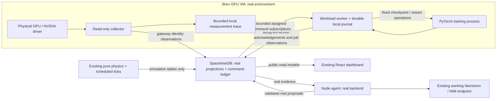

# Real environment integration: Brev GPU telemetry and workload recovery

**Date:** 2026-11-08, America/Chicago.

**Status:** Implementation proposal; no hardware integration or live acceptance is certified by this document.

**User constraint:** $60 in Brev credits. Time remaining and the actual Brev instance rate are unknown.

**Source inspected:** local `lane/p2-r-sprint`, HEAD `7d37021`, including an active, uncommitted P2 working tree. Record a fresh commit before implementation; do not overwrite concurrent P2 changes.

## 1. Outcome and recommended scope

Make DataCenterOS demonstrate two complementary capabilities:

1. Its existing fixed 64-GPU simulator rehearses cooling failures, placement safety, overlapping incidents and durable coordination.
2. A small Brev environment supplies actual GPU measurements and runs a real training process that can checkpoint, fail and resume under a durable recovery workflow.

The minimum real-environment deliverable is **one GPU VM, authenticated measured telemetry, a real training job, and verified checkpoint/restart recovery on that VM**. A second VM for cross-machine recovery is an extension after this works. The number of GPUs shown as real must equal discovered hardware.

The real workload is not one of the simulator's fixed 16/8/8-GPU jobs. Give it its own identity, state, commands and evidence. Retain the simulator as a separate, clearly labeled rehearsal surface. Do not turn the 64 simulated tiles into 64 alleged hardware devices by repeating one GPU's readings.

This user-requested extension makes real telemetry a delivery priority for this workstream. Existing [scope](IMPLEMENTATION-SCOPE.md), [tasks](IMPLEMENTATION-TASKS.md) and [contracts](CONTRACTS.md) still govern the simulator. Their optional-hardware designation describes the earlier submission scope. Real workload control requires the explicit additive interfaces proposed here; it is not already covered by P2-9.

### Delivery levels

| Level | Deliverable | Allowed claim | Exit condition |
|---|---|---|---|
| L0 | Discovered GPU and captured measurements | “These are readings from this GPU” | UUID/model and a saved measurement trace |
| L1 | Live collector → DB → dashboard | “We monitor a real GPU environment” | Fresh/stale/reconnect tests pass; no synthetic substitution |
| L2, target | Real checkpointable job + agent recovery | “We resumed this training job after a process failure” | Saved checkpoint restored; fresh steps advance; durable action reconciliation passes |
| L3, stretch | Second VM and verified transfer/restart | “We recovered this job on another machine” | Destination identity, checkpoint hash and single active attempt verified |

L1 is a useful fallback if time runs out. It must not be presented as L2. A real GPU temperature graph alone does not establish recovery automation.

## 2. Current code and exact integration gaps

| Current implementation | Finding | Required integration |
|---|---|---|
| `packages/physics/src/gpu/telemetry.ts` | Emits `source_kind: simulator`, estimated measurements and simulated faults | Leave this data correctly attributed; add a separate collector |
| `packages/physics/src/gpu/constants.ts` | Defines illustrative limits and reserved `gpu-real-0` / `node-real-0` | Use reserved IDs only for the first discovered hardware pair; keep actual capabilities separately |
| `apps/db/src/index.ts` | Exports no ingestion reducer | Add/export `ingest_observations` |
| `packages/db-client/src/live.ts` | `ingestObservations` throws `INVALID_TRANSITION` | Implement the existing wrapper over generated bindings |
| `packages/db-client/src/mock.ts` | Has in-memory ingestion validation | Extend meaningful parity tests; a passing mock is not live ingestion evidence |
| `apps/web/src/components/heatmap/RealGpu.tsx` | Reads four `nvidia_smi.*` metrics from `hardware` / `collector=nvidia-smi` | Reuse initially; move reads to durable latest hardware projections and add capability/freshness information |
| `apps/db/src/projection.ts` | Full-set `sync(..., prune=true)` deletes rows absent from the simulator world, including `gpu_current` | Do not insert real current state into a table the next simulation tick prunes |
| `apps/db/src/tick.ts` | Caps `telemetry_recent` globally at 2,000 rows, ordered by simulation time | Real latest state/history needs independent retention; otherwise hardware evidence can vanish quickly |
| `apps/db/src/run.ts` | One fixed-ID run per DB; resetting it clears run-scoped state | Bind real sessions to a run generation and define an explicit quiesce/reset protocol |
| `packages/db-client/src/live.ts` | `getEvidence` windows by simulation time | Add a wall-time real evidence read; do not use sim-time windows for hardware freshness |
| `apps/agent/src/main.ts`, `triage.ts`, `planner.ts` | Agent assumes the simulator snapshot, fixed thresholds, GPU gang jobs and physics forecasts | Add a real backend/loop with bounded real actions; do not feed hardware blindly into the existing planner |
| `apps/db/src/actions.ts`, `tick.ts` | Existing actions are executed/settled by physics inside the DB | Real external actions need a worker and separate completion/read-back protocol |
| `hardware/` | Directory/collector absent in this checkout | Create only the hardware runtime needed for this plan |

Current source includes in-progress provenance and plan/workflow subscription changes. Reuse their final integrated APIs rather than implementing a second version. No live service, private configuration or credit balance was inspected for this plan.

## 3. Architecture and component responsibilities



Responsibilities:

- **Collector:** read hardware, normalize units, identify capability gaps, persist a bounded outgoing spool and publish observations. It cannot create recovery commands or report their success.
- **Worker:** own one allowlisted training process per real job, execute fixed operations, journal their identity/outcome and publish observations. Run independently from the agent process.
- **Database:** authorize ingress, preserve provenance, deduplicate requests, own coordination/command records and enforce worker assignment/fencing. It performs no SSH, CUDA or filesystem I/O.
- **Agent:** assess actual evidence, choose among supported operations, reconcile existing commands after restart, and verify results from later observations. Code enforces permissions and prerequisites.
- **Dashboard:** show source, capabilities, actual device count, job/attempt identity, command lifecycle and verified effects. Browser credentials are read-only in public builds.

Use existing SpacetimeDB and Node services. A separate Kubernetes cluster, Slurm deployment, Grafana stack or new database is not required for L1/L2.

## 4. Brev provisioning and the $60 budget

### Selection

Start with the cheapest available full-GPU VM that runs the small PyTorch workload and exposes usable driver telemetry. Check an L4/A10-class option or a low-cost available equivalent before paying for an H100. Do not assume any particular GPU, price, privilege or field is available until discovery succeeds.

Brev documents GPU VMs with CUDA, Docker and SSH. Running instances incur compute charges; stopped instances can retain storage charges, and capacity may prevent an immediate restart. Save artifacts outside the VM before stopping/deleting it. [Brev instance lifecycle](https://docs.nvidia.com/brev/concepts/gpu-instances)

Prefer the already working Nemotron endpoint. Brev credits fund Brev resources; this plan does not assume they pay for hosted model API use. If NIM already consumes the only GPU, either measure and label that inference workload first, or provision a separate small training GPU within budget. Record co-tenancy; it changes utilization and latency.

### Budget envelope

| Allocation | Ceiling | Purpose |
|---|---:|---|
| Development and integration | $35 | One VM while implementing and validating |
| Rehearsal and judging | $15 | Keep the verified environment available |
| Contingency | $10 | Storage/other displayed charges, retries or a brief second VM |
| Total | $60 | Never assume an automatic spending cap exists |

Before launch record the console's hourly rate, provider, region, stoppability and any extra displayed charges. The available development hours are `($35 - development extras) / total hourly compute rate`. Example arithmetic only: $35 is 11.7 hours at $3/hour, or 5.8 hours at $6/hour. These are not Brev price quotes.

Set a local reminder from that measured rate and check console usage at each milestone. Stop optional development before consuming the rehearsal reserve. An alert is not a provider-enforced cap. A second VM must fit the remaining balance and the reserved presentation window.

### Discovery artifact

Before integration capture a redacted `discovery.json` with code revision, UTC timestamp, instance label, GPU UUID/model/count, driver/CUDA/PyTorch versions, supported metrics, accessible temperature thresholds, GPU visibility and checkpoint-directory writeability. Record public pricing separately; omit tokens, SSH keys, private network details and signed artifact URLs.

## 5. Repository layout and ownership

All paths below are proposed additions unless listed in §2 as existing. Names are implementation targets, not commands/APIs already available.

```text
hardware/
  brev-runtime/                         # new workspace TS package, @dcos/brev-runtime
    package.json
    src/{config,discover,collector,normalize,spool,main}.ts
    src/{worker,journal,process-registry,checkpoint-store}.ts
    test/
    requirements.txt                   # pinned Python workload dependencies
    workload/{train,checkpoint}.py
    scripts/{launch,stop,record}.sh
    README.md
apps/db/src/
  ingest.ts                            # ingress, source registration and real read projections
  real-actions.ts                      # real command lifecycle; no physical execution here
  schema.ts, auth.ts, index.ts          # additive tables, roles and exports
packages/db-client/src/
  real.ts                              # typed real evidence/job/command access
  client.ts, live.ts, mock.ts, types.ts, index.ts
  generated/                           # regenerate after DB schema/reducers change
apps/agent/src/real/
  {loop,evidence,planner,coordinator,verify,resume}.ts
apps/agent/scripts/
  real-environment-test.ts
apps/web/src/
  data/real-environment.ts
  components/real/{Environment,Workload,Recovery,History}.tsx
docs/real-environment/
  runbook.md
  evidence-manifest.example.json
```

`hardware/*` is not included in the current `pnpm-workspace.yaml`; add `hardware/brev-runtime` explicitly. TypeScript owns collection, DB communication and worker coordination. Python is a deliberate narrow exception for the real PyTorch training workload. It is not a replacement Python orchestrator.

| Owner | Work |
|---|---|
| Integrator | Canonical additive schemas/types/examples, workspace registration, source precedence and integration |
| P2 / Kaushik | DB ingestion, source binding, real command records, client wrappers, bindings, reset guards |
| P3 / Suvan | Real agent backend, model attribution, reconciliation, observed verification and handoff |
| P4 / Karthik | Real-environment view, controls through existing local presenter policy, browser witness and runbook |
| Runtime implementer | Brev discovery, collector, workload and worker; assign a human owner before starting |

Use the team's integration branch and existing lane boundaries. Do not interpret this plan as authorization to publish/reset prod, provision a paid VM or send team messages during a documentation task.

## 6. Identity, environments and state separation

### Identity rules

- Keep `gpu-real-0` and `node-real-0` for the first hardware pair. Map them administratively to discovered GPU UUID and host identity. Never use enumeration index alone as persistent identity.
- Use an environment ID such as `env-brev-1`, a new random **generation ID** per enrolled session, and a per-process **source session ID**. All are constrained to canonical `Identifier` syntax/length.
- A source ID includes its session, for example `brev-gpu-session-a1`. `source_seq` is strictly increasing across events within that source session, not independently per metric.
- Bind each session to the authorized sender identity, environment generation, resource allowlist and metric allowlist in private DB state.
- On a new collector process, enroll a new session through the authenticated handshake. Do not reset sequence numbers under an existing source ID.
- Commands include environment generation, job ID and attempt ID. Reset or VM replacement cannot make an old command valid again.

L1/L2 attach the real environment to the current demo run for dashboard/workflow correlation, but store its current state in dedicated real tables. This avoids changing the existing one-run-per-DB assumption. The real view uses its own elapsed wall clock and does not build a fake `PhysicsWorld`.

### Data ownership

Keep simulator resources/jobs/actions in their existing tables. Real numeric observations, real job state and real execution records use dedicated tables in §9. Reuse incident/workflow/event infrastructure through explicit environment mappings, with IDs prefixed by environment generation. Add typed client reads for those mappings. Register the shared row and its context binding in one transaction; a naming convention alone is not backend isolation.

Scope incident/workflow listing, subscriptions and resume enumeration by backend before starting both agents. Legacy simulation adapters exclude real-bound rows; real adapters require the selected environment/generation. In particular, do not let `resumeOpenWorkflows` claim every open workflow across both backends. Cover this with a simultaneous simulator/real-workflow integration test.

`gpu-real-0` remains nonallocatable in the simulation engine. A real job's binding to its actual GPU is stored in `real_job_current`, not simulated `job_gpu_allocation`. No physics rule is relaxed to enable hardware control.

Do not implement P2-9's proposed direct `gpu_current` write unchanged: projection currently prunes it. The preferred L1 read model is `real_metric_latest` plus `real_resource`. If a later compatibility projection into `gpu_current` is necessary, explicitly preserve hardware-owned rows in projection, require a complete valid row and add a tick-survival regression. That projection is not needed for this plan's first release.

## 7. Telemetry collection and metric contract

### Collection choice

Use a one-shot `nvidia-smi` query on a 1-second timer initially. Spawn it with a fixed executable/argument array, a timeout and no overlapping polls. Detect supported fields during discovery; do not let an optional unsupported field break every measurement.

This is a starting discovery command, to be verified against `nvidia-smi --help-query-gpu` on the installed driver:

```sh
nvidia-smi --query-gpu=uuid,name,temperature.gpu,utilization.gpu,memory.used,memory.total,power.draw,power.limit,clocks.sm --format=csv,noheader,nounits
```

NVIDIA documents queryable CSV output but does not guarantee CLI output compatibility across versions. Preserve the driver/query configuration in the manifest. NVML is the preferred subsequent adapter for structured long-term integration. [nvidia-smi](https://docs.nvidia.com/deploy/nvidia-smi/), [NVML](https://docs.nvidia.com/deploy/nvml-api/latest/)

### Metric mapping

| Raw source | Canonical telemetry metric | Unit / conversion | Required for L1 |
|---|---|---|---|
| `temperature.gpu` | `nvidia_smi.temperature_gpu` | `degC`; finite numeric value | At least one real numeric metric must be supported; explain gaps |
| `utilization.gpu` | `nvidia_smi.utilization_gpu` | `ratio`; divide percent by 100 | Preferred |
| `power.draw` | `nvidia_smi.power_draw` | `W`; label sample semantics as reported by driver | Preferred |
| `power.limit` | `nvidia_smi.power_limit` | `W`; observation only | Optional |
| `clocks.sm` | `nvidia_smi.clocks_sm` | `MHz` | Preferred |
| `memory.used` | `nvidia_smi.memory_used_bytes` | `bytes`; MiB × 1,048,576 | Preferred |
| `memory.total` | `nvidia_smi.memory_total_bytes` | `bytes`; MiB × 1,048,576 | Preferred |
| UUID/model | Registered resource metadata | Strings, not numeric telemetry | Required |
| Supported throttle indicators | Explicit collector-specific metrics | Preserve documented bits/semantics | Optional; capability checked |

Use `source_kind: hardware`, `quality: good` for valid measurements and `labels.collector: nvidia-smi`. Labels also carry environment ID, generation, GPU UUID and collector version. `source_id` binds to private registry state, so labels alone cannot establish provenance.

`N/A`, unsupported fields, parse failures, NaN and infinities are not zero. The current `TelemetryEvent.value` requires a number: omit unavailable numeric samples and publish capability/error status separately. Retain a last valid reading with its original timestamp and display its age. Do not keep publishing that value with a new timestamp.

### Polling and buffering defaults

- GPU poll: 1,000 ms; subprocess timeout: 2,000 ms; skip an overlapping poll and record it.
- Publish one bounded batch per poll; maximum 64 events and 64 KiB of encoded JSON per request initially. Measure reducer runtime and tune downward if necessary.
- Source heartbeat: 2 seconds, independent of metric changes. Empty successful polls still update health through the source heartbeat endpoint.
- Outgoing spool: durable, bounded to 5 minutes or 10 MiB, whichever comes first. On overflow drop oldest measurement batches with an explicit gap counter; never drop command outcomes through this telemetry policy.
- Reconnect: capped exponential backoff, preserving original sample timestamps and event IDs. Buffered old samples can enter history but cannot make latest health fresh.

These are project defaults to validate, not established platform limits.

### Host and facility data

After GPU/job recovery works, add CPU usage, RAM, filesystem free space and network counters from the same VM. Node Exporter is an optional source for hardware/kernel metrics; normalize counter rates from time-separated samples. [Node Exporter](https://prometheus.io/docs/guides/node-exporter/)

Brev GPU telemetry does not establish rack inlet temperature, pump flow, cooling capacity, facility power headroom or physical rack topology. Keep those fields unavailable in the real view unless a separate authorized source supplies them. A microphone/fan demonstration is an explicitly labeled observation/mapping, not measured cloud cooling capacity.

## 8. Clock, freshness and replay semantics

The existing simulator uses logical time; real operations use wall time and local monotonic durations.

| Timestamp | Authority | Use |
|---|---|---|
| `observed_unix_ms` | Source measurement timestamp | Sample age and historical display |
| `received_unix_ms` | DB transaction timestamp | Delivery delay and source reception health |
| Monotonic elapsed duration | Local collector/worker | Poll timing, throughput windows and measured operation duration |
| `sim_time_ms` on legacy event | DB-stamped current demo clock at first acceptance | Compatibility/correlation only; never real freshness |
| Environment elapsed time | Wall time since session enrollment | Real-view timeline, independent of simulation speed/pause |

At ingestion overwrite the hardware event's compatibility `sim_time_ms` using the DB's current run clock. Keep it stable on accepted retries. Store actual observations/history by source timestamp and DB receipt time. Pausing/speeding the simulator does not pause/speed hardware ingestion or real actions.

Initial freshness policy: fresh through 5 seconds, delayed over 5 through 15 seconds, stale beyond 15 seconds. Show both source sample age and last heartbeat age. A future timestamp more than 5 seconds ahead of DB time is invalid for control, even if displayed as clock skew. Reject samples older than the 5-minute ingestion window; accept still-buffered samples within the window as historical only when stale. Reordered older observations must never replace newer latest values.

Control requires fresh relevant GPU and job observations, an active source/worker session and valid generation. UI freshness must update on a wall timer even when no DB row changes. Losing a collector is “telemetry unavailable”; it is not proof the GPU failed.

Recorded replay keeps original timestamps and uses `source_kind: replay` in a read-only replay session. Replaying must not update live control eligibility, latest live state, live source health or real commands. Replay is a separate local/file view for the first release.

## 9. Additive schemas, DB tables and APIs

### Canonical definitions

Integrator adds definitions to `packages/contracts/schema/contracts.schema.json`, then regenerates types and updates examples/validators. Keep current `TelemetryEvent`, `SignalEvent`, `ActionCommand` and `EvaluationResult` shapes compatible. Register every new type with the actual validator implementation; adding `$defs` alone is not assumed sufficient.

Proposed new definitions:

| Type | Required content |
|---|---|
| `RealEnvironment` | IDs/run/generation, observation-only or recovery-enabled mode, enrollment time, configured limits, enabled state |
| `RealResource` | Environment/generation, resource ID, host ID, GPU UUID/model, driver, collector capabilities and version |
| `RealSourceHealth` | Source/session identity, received heartbeat/sample times, sequence cursor, clock status, gap/error counts |
| `RealJobObservation` | Environment/generation, job/attempt/host/GPU IDs, worker session, status, step, total target steps, loss if available, observation time, checkpoint reference, version |
| `RealCheckpointManifest` | Job/config/code revision, checkpoint ID/hash/size, completed step, optimizer/schema version, complete state, host-local availability, creation time |
| `RealCommand` | Command key/hash, workflow, environment/generation, job, operation, expected job/attempt/checkpoint version, worker assignment and deadline |
| `RealCommandStatus` | Lifecycle/version, claim token, worker session, journal reference, actual start/finish times, result/failure/verification evidence |
| `RealEvidence` | Snapshot of permitted hardware/job/source/checkpoint facts, as-of wall time, incident references and explicit unknowns |
| `RealWorkloadEvent` | Job/attempt, event kind such as `process_exited`/`checkpoint_committed`, exit status, wall timestamp and evidence |

Use strict objects, bounded strings/arrays, finite numeric ranges, canonical IDs and generated wire types. A real workload process exit is a `RealWorkloadEvent`, not a fabricated GPU Xid. Optional mapping to an existing `equipment_alarm` must retain `domain=workload` and the actual process evidence; do not invent a new legacy `SignalEvent.event_type` without schema coordination.

### Proposed table set

| Table | Key / visibility | Purpose |
|---|---|---|
| `real_environment` | Environment ID; public safe metadata | Active generation, parent run, mode and limits |
| `real_resource` | Environment + resource; public | Discovered identity/capabilities; no credentials |
| `real_source_registry` | Source/session ID; private | Sender binding, allowlists, generation, cursor, enabled state |
| `real_source_health` | Source/session ID; public safe fields | Last sample/heartbeat, gaps and errors |
| `real_ingest_receipt` | Source + canonical batch hash; private | Retry acknowledgement and accepted sequence range |
| `real_metric_latest` | Environment + generation + resource + metric; public | Last valid real numeric sample and both timestamps |
| `real_metric_history` | Event ID; public redacted values | Independently bounded measurement history |
| `real_job_current` | Environment + job; public | Actual attempt/status/step and checkpoint reference |
| `real_checkpoint` | Environment + checkpoint ID; public safe manifest | Completed artifact identity and verified local availability |
| `real_command` | Generation + command key; public safe projection | Durable intent, worker ownership, lifecycle and result |
| `real_command_event` | Event ID; public | Lifecycle and verification history |
| `real_workload_event` | Event ID; public safe observation | Actual job exit/checkpoint/attempt evidence, independently of simulator signals |
| `real_context_binding` | Entity kind + ID; public safe metadata | Environment/generation discriminator for shared incident/workflow/event records |

Native composite keys or a canonical encoding may be used according to the installed SpacetimeDB SDK. Hash a canonical tuple when delimiter ambiguity is possible. Index by environment/job/status and avoid full-history scans per sample.

L1 only needs environment/resource/source/receipt/metric tables. L2 adds job/checkpoint/command/workflow tables. Additive schema changes require module publish and regenerated SDK bindings; test on a designated local/dev target first. Do not clear existing DB data to introduce these tables.

### Proposed reducer/client surface

| Operation | Caller | Behavior |
|---|---|---|
| `register_real_environment` | Admin | Enroll discovered resource mappings and set observation-only default |
| `enroll_real_source` / `heartbeat_real_source` | Bound gateway/worker | Allocate/refresh an allowed source session; no arbitrary resource enrollment |
| `ingest_observations(batch_json)` / existing `ingestObservations(batch)` | Bound gateway | Validate canonical numeric/signal events and update dedicated real projections |
| `publish_real_job_observation`, `publish_real_workload_event` | Assigned worker | Update only its assigned job/attempt; validate manifests and versions |
| `publish_real_checkpoint` | Assigned worker | Commit an immutable complete manifest for its job; never upload checkpoint binary content into the DB |
| Real-scoped incident/workflow/event wrappers | Agent/admin | Reuse shared persistence logic while atomically writing/checking context bindings |
| `request_real_action` | Agent/admin | Validate current evidence, workflow ownership, supported operation and unique intent |
| `claim_real_action` / `start_real_action` | Assigned worker | Atomically reserve job, fence ownership and obtain current start authorization |
| `report_real_action` | Assigned worker | Persist progress/outcome for the current command/token/session |
| `verify_real_action` | Agent/admin | Persist postconditions separately from worker success |
| `quiesce_real_environment` / `rotate_real_generation` | Admin | Stop accepting new work and invalidate old sessions through controlled teardown |
| `getRealEvidence`, `getRealCommandStatus`, `onRealEnvironment`, `onRealJobs`, `onRealCommands` | Public safe reads | Typed read models scoped to environment/generation |

Exact argument shapes are frozen with canonical schemas in task H1. These names are proposed additions. Existing `DbClient.mode` remains `mock | live`: “live DB connection” and “hardware data source” are separate dimensions.

### Configuration and rollout

Use the existing ignored `.env.local` conventions. Add only non-secret placeholders to tracked templates. Proposed runtime settings:

| Setting | Consumer | Purpose |
|---|---|---|
| Existing `STDB_URI`, `STDB_DB`, `STDB_GATEWAY_TOKEN` | Collector | DB target and observation identity |
| `STDB_WORKER_TOKEN` | Worker only | New narrowly scoped worker identity |
| `DCOS_REAL_ENVIRONMENT_ID`, `DCOS_REAL_GENERATION_ID` | Collector/worker/agent | Explicit selected environment; generation confirmed by DB enrollment |
| `DCOS_COLLECT_INTERVAL_MS=1000` | Collector | Bounded measurement cadence |
| `DCOS_RUNTIME_DIR` | Worker | Persistent private journal/checkpoint directory |
| `DCOS_REAL_RECOVERY_ENABLED=false` | Agent/worker | Local opt-in in addition to DB-enforced environment mode |
| `DCOS_AGENT_BACKEND=simulation` | Agent | Existing behavior remains default until real mode selected |
| `VITE_REAL_ENVIRONMENT_ID` | Browser, public | Optional initial environment selection; never an authority or credential |

The effective capability is the intersection of DB mode, assigned identity and local configuration; setting an environment variable cannot authorize control. Add settings to the actual config loaders, redactors and validation tests. Do not place gateway/worker/agent credentials in a `VITE_*` variable. Display only a redacted effective configuration and stop clearly on a wrong generation/DB.

Roll out consumers that can read the new tables/types with recovery disabled, then enroll sources, then validate L1. Enable real commands only after worker/agent compatibility and H4 tests pass. A rollback disables real dispatch, quiesces/reconciles external jobs and keeps telemetry/history readable; reverting application code does not undo a training process already launched. Record module/client/runtime versions together in the environment manifest.

### Authorization and ingestion rules

1. Require `gateway` role plus a private sender/source/resource/generation binding; having the role alone does not authorize writing any GPU.
2. Validate the entire batch before committing any row. Reject unknown metrics/units, wrong resources, non-finite values, invalid timestamps, replay in live ingress, excessive payloads and inactive generations.
3. Validate monotonically increasing sequences across the whole source batch. An event ID reused with different content is rejected.
4. Persist per-source cursor and exact-batch receipt atomically with samples. An exact whole-batch retry returns its previously committed acceptance without creating new samples. A repeated event inside a different batch remains invalid.
5. Compute the receipt hash from canonical submitted content **before** DB timestamp stamping. First enforce current sender/generation authorization; then check an existing exact receipt before applying new-batch age/cursor rules. A retry returns the previous acceptance without updating freshness. Retain receipts for at least the 5-minute spool/retry window plus margin; proposed 10 minutes with a measured bound.
6. This exact-batch retry behavior is a deliberate refinement of old P2-9's blanket duplicate rejection. Update that checkpoint and mock/live tests together. If a receipt expired, return a typed rejection and let the collector inspect the acknowledged cursor/receipt state; do not silently regenerate event IDs.
7. Latest values update only for newer valid measurements; historical backfill cannot refresh health. Heartbeat reception and measurement freshness are separate facts.
8. Hardware source failures become source-health events. No real Xid is emitted unless actually observed through an authorized NVIDIA/driver source.

Start with 5 minutes of independently retained hardware history at 1 Hz. Ten metrics on one GPU are about 3,000 rows over five minutes. Set an explicit per-environment row ceiling, prune independently of simulation history, and load only a recent chart window in the browser. Latest rows remain after history pruning and become stale normally.

## 10. Real training workload and checkpoint implementation

Use a small CNN on a fixed, locally cached dataset such as Fashion-MNIST if download time permits. The product value is observable work preservation, not training a large model. If an offline deterministic synthetic dataset is chosen for reliability, label the dataset synthetic while correctly describing compute, telemetry and checkpoint I/O as real.

The workload should run long enough to rehearse recovery; make total steps configurable and emit progress once per second. Measure a baseline before choosing batch size. Do not tune it to reach simulator temperatures or copy the demo's 700 W/85°C assumptions onto the hardware.

### Required workload behavior

- Single-GPU, non-distributed process; one active attempt per job.
- JSONL progress: job/attempt, step, loss, monotonic elapsed time, steps/s and checkpoint state.
- Checkpoint every configurable interval, initially 20–30 wall seconds, and on a fixed worker control request handled at a training-step boundary.
- Save model, optimizer, scheduler if used, step/epoch, data position, RNG states, workload config and code revision. PyTorch documents model and optimizer state as necessary for a general training-resume checkpoint. The additional exact-resume state is a project requirement. [PyTorch checkpointing](https://docs.pytorch.org/tutorials/beginner/saving_loading_models.html)
- Write a temporary file in the same filesystem, flush/fsync, atomically rename, fsync the directory where supported, calculate SHA-256 and commit a manifest. Only then report `complete`/advance protected step.
- Load only the workload's own verified artifacts; check manifest/hash/config compatibility before resume. Use the installed PyTorch version's supported loading mode and test any RNG-state representation against it.
- Prefer an epoch-boundary or explicitly indexed deterministic sampler for the first release; no hidden multiworker prefetch state. Test the claimed resume fidelity rather than assuming model weights alone reproduce training.

The durable progress measure is **checkpoint step**, while current progress is **observed training step**. Do not convert either into simulator work units or GPU-hour savings. On restart record the steps lost since the last completed checkpoint.

### Local checkpoint store

Use persistent workspace storage, for example `/home/ubuntu/workspace/dcos-runtime/<environment>/<job>/`. Keep the latest two complete checkpoints and a manifest history. Write-once checkpoint IDs prevent retries from overwriting a previously committed artifact.

A checkpoint on this VM can survive a training-process crash. It does not prove recovery after VM deletion or host/storage loss. Export a copy to the presenter machine for backup. Shared/object storage and cross-host accessibility are L3 requirements, not implicit properties of a local path.

## 11. Real command execution and durable reconciliation

### Supported operations

| Operation | Preconditions | Actual effect | Verification |
|---|---|---|---|
| `checkpoint` | Fresh running job; assigned worker; writable local store | Ask workload to commit a checkpoint | Matching complete manifest/hash and protected step |
| `restart_from_checkpoint` | Previous attempt conclusively stopped; complete compatible checkpoint; fresh available worker/GPU | Start one new attempt with fixed executable/args | Correct resume step, one process identity, then advancing work |
| `keep_running` | Fresh running job | Record a decision without spawning work | Later progress from the same attempt |
| `escalate` | Reason/evidence and next step | Persist operator handoff | Read-back of handoff; no recovered-job claim |

Initial job launch is a presenter/admin bootstrap command through the assigned worker, using the same fixed workload configuration and process lock. Training termination for the demonstration is a test-harness action targeting only that worker-owned child; it is not an LLM tool.

Power-limit changes, device reset, clock changes, arbitrary shell, remote host reboot and physical fault injection are outside L2. Observing a power limit is sufficient. A real process failure is not labeled Xid79, GPU failure or cooling failure.

### Worker design

- Run the worker as an independent supervised process on Brev. Agent death on the presenter/Node side must not kill it or its training child.
- Add a narrow `worker` role to DB auth, separate from `gateway` and `agent`. Bind it to one environment/generation/host and assigned jobs. Observer credentials cannot report action success.
- Use a single worker instance per host and an exclusive per-job lock. Record attempt ID, PID plus process start identity, workload/config hash and GPU UUID; a PID alone is insufficient after reuse.
- Keep a durable local command journal under persistent workspace storage. Choose/pin a Node-22-compatible transactional SQLite dependency during H0/H1, test packaging on Brev, and use a uniqueness constraint on generation/job/command key. Do not assume a particular experimental Node built-in is available.
- Journal accepted intent before launching work. Record checkpoint commit and process identity before reporting success. After worker restart reconcile the journal with existing process/artifact state before accepting another launch.
- Store the highest accepted fencing token/generation locally. Validate current DB authorization before a new external effect; persist token changes before effects.
- On DB disconnection, an already-running training process can continue and an already-accepted checkpoint can finish into the journal. No new restart/launch begins without current authorization. Reconcile outcome on reconnect.

### Command state machine

```text
requested -> claimed -> running -> succeeded
    |           |          |        |
    +-> blocked +-> failed +-> needs_reconciliation

verification: pending -> verified | unverified | operator_review
```

`blocked` is a real-command status, not a new legacy `ActionStatus` value. Either map it explicitly to a display model or keep the real status type separate. Worker success and agent verification are separate fields; a successful process spawn is not verified workload recovery.

### Request/start checks

Validate environment enabled/mode, generation, workflow ownership, expected job/attempt version, completed checkpoint identity, worker assignment, heartbeat/sample age, available local disk and absence of conflicting work. Require a stopped prior attempt for restart. Record precise reason/evidence for rejection. An unknown checkpoint, stale observation or uncertain process identity blocks launch.

Do not require a GPU to be idle just because utilization is nonzero: the running job or co-tenanted NIM may explain it. Require capacity appropriate to the configured small job and recorded ownership. If actual available capacity cannot be established, escalate.

### Agent crash/retry behavior

1. The agent reclaims the persisted real workflow and reads every existing command key.
2. Completed commands are verified/read back; running commands are awaited/reconciled; absent intended commands reuse the same key and payload.
3. Changed intent gets a new key. Same key/different hash is rejected.
4. The worker receives retries and consults its journal/process registry before any external effect.
5. A stale owner cannot start/cancel/report protected work after takeover. A stale worker cannot overwrite a newer attempt.
6. If worker failure leaves an uncertain old training process, stop and reconcile it on the same host. Do not launch a replacement on another host merely because a lease expired.

The demonstrated guarantee is bounded duplicate prevention/reconciliation for this managed worker and workload. DB transactions/fencing do not establish universal exactly-once external execution. Artifact/process reconciliation closes the crash windows exercised by the tests.

## 12. Agent and Nemotron integration

Add explicit backend selection, for example `DCOS_AGENT_BACKEND=simulation|real`, with simulation as the compatibility default. A real backend receives `RealEvidence`, not a fabricated full `ObservedSnapshot` containing invented racks/pumps/headroom.

Reuse the existing NIM client, redaction, bounded validated tools, event publishing and workflow ownership where their semantics fit. Keep the simulator planner/physics port intact. Add real-specific symptom extraction, supported-action enumeration and verification.

### Real decision flow

1. Code detects a process exit, stalled training, missing collector, unavailable checkpoint or worker uncertainty from actual observations. Low GPU utilization alone is not proof of failure.
2. Build a bounded evidence bundle with current timestamps, job/attempt identity, recent steps, exit observation, checkpoint manifests and available actions. Exclude pending harness fault schedule and credentials.
3. Nemotron can classify/explain the incident and choose `keep_running`, `checkpoint`, `restart_from_checkpoint` or `escalate` from the enumerated options. It cannot supply a shell command or arbitrary path.
4. Code validates the choice, rereads evidence after model latency and submits a real command through the normal ledger/worker path.
5. Observe effects, verify, then persist a handoff. Record actual model requests/responses, cache/fallback counts, model ID and wall latency.

Model outage policy: deterministic code may perform the preconfigured bounded restart when all hard prerequisites are fresh and satisfied; otherwise escalate. Attribute it to `code` and show fallback. A violation-free deterministic policy is not permission to bypass missing/stale observations.

Until the real backend is complete, the hardware panel is observation-only. Do not imply the existing simulator planner is controlling the real GPU. Filter simulator inputs to simulator-owned resources/evidence, and filter real workflows by their binding/generation so neither loop processes the other's commands or incidents accidentally.

### Recovery verification

Require two fresh job observations at least 5 wall seconds apart after restart, from the expected new attempt on the registered host/GPU. Both must be consistent with the checkpoint/config; training steps must advance beyond the resumed checkpoint step. If the short job finishes inside that interval, verify completion plus its saved final artifact instead of requiring nonexistent subsequent running samples.

Verify actual loaded checkpoint hash/step, absence of a second active managed attempt, relevant GPU/source freshness, and no terminal process error during the window. GPU utilization can support the explanation but is not the proof of correct training progress. A paused simulator, old DB action success or unchanged step is insufficient.

Persist evidence IDs/timestamps, checkpoint/attempt identities, outcome, unresolved uncertainty and next human action in the real workflow handoff. A fresh client must read it after agent restart and history pruning.

## 13. Dashboard integration and operator flow

Keep the existing visual system and add a “Real environment” surface/tab. The global `mock|live` connection label remains distinct from per-panel data provenance.

Required real view:

- Actual host/GPU count, GPU model/UUID suffix, collector/worker state and measured source age.
- Latest temperature, utilization, memory, power and clocks where supported; missing metrics say unavailable.
- Recent wall-time charts with visible gaps; last-known values are visually stale instead of interpolated as current.
- Real workload step/loss/throughput, protected checkpoint step/age, attempt ID, resume point and observed lost steps.
- Real incident/workflow stage, Nemotron/code attribution, bounded tool summaries and explicit waiting/reconciling/operator-review states.
- Real command operation, prerequisites, timing, outcome and verification facts. Do not mix its lifecycle silently into the physics ledger.
- Persistent handoff and a clear “training process failure — controlled test” annotation for the demonstration.

In real mode, simulation pause/speed/reset controls act only on the simulation surface and are labeled accordingly. Disable a shared reset while a real worker/job remains active; use the quiesce procedure below. Public deployment stays read-only; local presenter controls use the existing authorized pattern.

Refactor `RealGpu.tsx` to read `real_metric_latest`/capabilities, not only `getEvidence(...simulation window...)`. Subscribe to typed real state in a separate store that survives hardware updates while the simulator is paused. Reconnection reconstructs the active generation from DB rather than cached browser history.

If DCGM is added later, extend the source/metric adapter explicitly. The current panel's `collector=nvidia-smi` filter will otherwise reject those readings. DCGM's Prometheus endpoint and available fields are documented by NVIDIA; deployment and supported fields must be checked on the chosen VM. [DCGM Exporter](https://docs.nvidia.com/datacenter/dcgm/latest/reference/command-line-reference/dcgm-exporter.html)

## 14. Lifecycle, reset and disconnection

### Startup order

1. Capture source revision, rate/budget and discovery artifact.
2. Publish additive module/bindings to named disposable local/dev DB; run schema/auth smoke checks.
3. Admin enrolls environment/resource mappings and private source/worker grants.
4. Collector starts; require at least 10 fresh received samples and identity agreement.
5. Worker starts and reconciles its journal; initially recovery disabled.
6. Presenter bootstraps the real job; require a completed checkpoint and observed progress.
7. Enable recovery for this environment; start real agent backend.
8. Attach dashboard and run the controlled failure test.

### Teardown/reset order

1. Mark environment quiescing so no new actions are accepted; stop agent/harness and await exit.
2. Let accepted checkpoints finish or report their failure; stop worker-owned training processes and reconcile manifests/journal.
3. Stop collector/worker, close clients and confirm no active attempt or external operation remains.
4. Export evidence/checkpoints needed for the demonstration; disable old source/worker sessions.
5. Rotate the environment generation. Reset the simulator only after this boundary is established.
6. Re-enroll fresh source/worker sessions if starting another run. Preserve the history manifest outside reset state.

Extend `create_run`/controlled-reset guards to reject reset while an attached real environment is active or has unreconciled commands. A new wrapper alone cannot protect a directly invoked reset reducer. Update the DB's `clearRun` handling deliberately for new tables; do not leave old rows control-eligible under a new run.

Never carry a source cursor/fencing counter across an implicit reset without its generation. Do not reset prod as part of tests. Use the existing P2 local/dev lock procedures and publish only through the project's normal integration process.

## 15. Implementation tasks and acceptance

Estimates below are engineering estimates for a familiar developer, excluding provider wait time, downloads and unresolved SDK issues. They are not a commitment to fit an unknown remaining hackathon window.

| Task | Owner | Depends on | Estimate | Deliverable / acceptance |
|---|---|---|---|---|
| H0: baseline and discovery | Runtime + P2 | — | 30–60 min | Integrated revision recorded; VM rate/capabilities discovered; budget recorded; no secrets in artifacts |
| H1: L1 schema/DB ingress | Integrator + P2 | H0 interface decisions | 2–3 h | Source-bound ingress, receipts, latest/history, wall-time evidence, regenerated types/bindings; negative auth tests |
| H2: collector and real panel | Runtime + P4 | H1 | 1–2 h | Actual measurements reach browser; history/freshness/reconnect tests; reaches L1 |
| H3: checkpointable workload | Runtime | H0 | 1–2 h | Actual GPU training, complete atomic checkpoint, manual supervised restart with compatible state |
| H4: real command/worker protocol | P2 + Runtime | H1, H3 | 2–4 h | Local journal, assigned worker, idempotent restart, crash reconciliation and reset guard |
| H5: real agent + verification | P3 + P4 | H2, H4 | 2–3 h | Nemotron/code choice from real evidence, postcondition read-back, persistent handoff |
| H6: failure rehearsal/artifacts | P2/P3/P4 | H5 | 1–2 h | Acceptance matrix, browser witness, two rehearsals, saved backup and measured latency; reaches L2 |
| H7: second VM | Runtime + P3 | Stable L2 + remaining budget | Separate estimate | Hash-verified transfer, source stopped, destination attempt/progress verified; reaches L3 |

Some human-owned tasks can proceed independently; this plan does not require spawning agents. One developer should budget roughly 10–17 hours for robust L2 rather than treating it as a telemetry-only patch. L1 may fit a shorter 3–6-hour window, depending on SDK/deployment friction. Reassess after H0/H1 with actual time and credit consumption.

### Incremental delivery order

1. Freeze the current working baseline and interfaces; implement L1 locally using labeled parser/ingress fixtures before spending most VM time.
2. Keep collector → DB → browser working before adding external commands.
3. Prove local workload checkpoint/resume independently before involving Nemotron.
4. Prove deterministic DB/worker recovery and crash windows before model-assisted selection.
5. Add model attribution, verification/handoff and rehearse.
6. Spend on a second VM only after L2 evidence is saved.

If time/budget is short, stop at the last passed delivery level. Cut DCGM, host dashboards, second VM, cloud checkpoint storage and presentation polish before cutting identity/freshness/recovery verification. Do not rush a real-control path behind a working monitoring panel.

## 16. Test matrix and meaningful evidence

### Unit/contract checks

| ID | Case | Required assertion |
|---|---|---|
| T01 | Supported, unsupported and malformed NVIDIA fields | Correct units; unsupported/invalid is unavailable, never zero |
| T02 | GPU reordering / collector restart | UUID mapping remains stable; new source session has valid cursor |
| T03 | Wrong identity/resource/generation | Entire ingress batch rejected without partial writes |
| T04 | Exact retry / duplicate in changed batch / changed payload | Exact accepted batch no-ops; conflicting duplicate rejects |
| T05 | Backfill / future timestamp / clock skew | History/latest/freshness behavior follows §8 |
| T06 | Simulation paused, speed 5, many ticks | Hardware remains wall-time fresh; projection never deletes latest state |
| T07 | Retention / spool overflow | Independent bounds hold; gaps explicit; latest and command outcomes preserved |
| T08 | Checkpoint crash before/after rename/manifest | Protected step advances only with a verified committed artifact |
| T09 | Same command after lost acknowledgement | Worker returns journal outcome without a second checkpoint/launch |
| T10 | Same key changed intent / old token/attempt | Rejection; no external process effect |
| T11 | Stale evidence / missing checkpoint / uncertain old process | No restart; recorded blocked/operator-review outcome |
| T12 | Worker/agent restart during start ambiguity | Existing process/artifact adopted or escalated; no blind duplicate launch |
| T13 | Model timeout/invalid action | Bounded fallback or escalation, actor code, hard prerequisites unchanged |
| T14 | Reset through wrapper and direct reducer | Active/unreconciled environment prevents reset; rotated generation rejects old sessions |
| T15 | Observation-only credentials and public browser | Cannot execute commands, enroll resources or report worker success |
| T16 | Finished workflow + pruned telemetry | Fresh client can still read persisted verification/handoff |
| T17 | Simulator and real agents active together | Each lists/claims/resumes only its backend's incidents/workflows; no cross-dispatch |

Tests must exercise effects and crash boundaries, not just mirror helper implementation. Real-runtime tests are explicitly named and do not run in default unit CI against a paid VM.

### Live acceptance on the same commit/DB/environment

| ID | Experiment | Evidence |
|---|---|---|
| A1 | Idle then training load | Raw collector records match normalized DB values and displayed timestamps; utilization/power response where supported |
| A2 | Stop collector while worker continues | Real panel becomes stale; no fabricated GPU outage or automatic restart |
| A3 | Resume collector/reconnect browser | Current values rebuild; gaps remain visible; no silent mock fallback |
| A4 | Terminate only worker-owned training child after a complete checkpoint | Actual exit observed, new attempt restores that checkpoint and advances steps |
| A5 | Kill actual agent while real recovery command is running | Worker/DB continue independently; fresh agent reconciles same key and verifies once |
| A6 | Lose DB acknowledgement after checkpoint/restart effect | Journal/artifact/process read-back prevents duplicate managed attempt |
| A7 | Truncate a test checkpoint or use wrong config hash | Restart blocked; previous valid checkpoint remains usable |
| A8 | Revoke session / replay old-generation command | No new effect and no current-state overwrite |
| A9 | Model unavailable | Deterministic recovery or escalation is explicitly disclosed |
| A10, L3 only | Recover on second VM | Transfer hash, destination GPU UUID, source stop and advancing destination attempt verified |

A1–A3 close L1. A4–A9 plus contract/auth tests close L2. The live harness takes explicit DB/environment IDs, refuses prod by default, targets only its managed child, waits on observed states and uses bounded wall-time timeouts. It saves failure artifacts instead of reporting a timeout as success.

Initial user-experience targets, to measure rather than assume: at 1 Hz sampling, p95 sample-to-browser latency at most 3 seconds on the rehearsal network; visible stale state by 16 seconds after source loss; restored current display within 5 seconds of a successful reconnect. Recovery duration has no invented fixed pass threshold: record its detection/decision/restore/verification components, set the harness timeout from a measured baseline and fit the presentation to that evidence. If targets are missed, retain the measured numbers and fix the relevant bottleneck or disclose it.

### Package checks

Use declared scripts and build physics before consumers. Existing commands include:

```sh
pnpm --filter @dcos/physics build
pnpm --filter @dcos/contracts test
pnpm contracts:validate
pnpm --filter db typecheck
pnpm --filter @dcos/db-client test
pnpm --filter agent typecheck
pnpm --filter agent test
pnpm --filter @dcos/web build
pnpm -r test
```

Add package scripts for the new runtime, Python workload checks and explicit paid/live harness as part of implementation. Do not copy a planned command into a status report as if it already exists or passed. Record actual versions/counts and the target DB.

## 17. Artifact format, metrics and presentation

Save a batch outside VM-only storage:

```text
docs/real-environment/evidence/<session>/
  manifest.json
  discovery.json
  observations.jsonl
  commands.json
  workload-events.jsonl
  checkpoints.json                    # manifests/hashes, not model binaries
  assertions.json
  report.md
```

Large raw recordings/checkpoint binaries belong in ignored artifact storage with a manifest/reference, not normal source commits. Add ignore entries before capturing them. Commit only small redacted fixtures/reports that fit repository policy. Never expose private paths/credentials through public command rows or signed download links.

Manifest includes code revision and dirty-state flag, collector/worker/workload versions, GPU/model/driver, environment/generation, DB target, actual start/end wall times, model ID/use/fallback counts, checkpoint hashes, artifact checksums, known gaps and acceptance results. The pricing/budget record is separate from scientific measurements.

Report measured real quantities:

- Collector-to-DB and DB-to-browser latency distributions, with source clock-skew caveat.
- Telemetry gaps/stale duration, supported/missing fields and actual GPU count.
- Checkpoint size/write duration and last protected step.
- Failure detection, model decision, command start, restore and verified-progress wall durations.
- Observed lost training steps, actual attempts and duplicate managed launches prevented/detected.
- Real agent restart/reconciliation outcome and remaining operator work.

Keep these separate from the simulator's `EvaluationResult` matrix, finite-horizon work deficit and offline zero-simulated-decision-latency metrics. A real recovery session is a different experiment. Do not publish its wall durations as simulator policy results.

### Suggested presentation sequence

1. Show “1 real GPU” with model/UUID, current measurements and source age.
2. Show real training steps/loss and an actual completed checkpoint/hash.
3. Trigger the labeled controlled training-process failure.
4. Show actual evidence, model/code selection, accepted command and restore attempt.
5. If rehearsed, kill/restart the actual agent while the worker continues recovery.
6. Show fresh advancing steps, one active managed attempt and persistent handoff.
7. Switch explicitly to the simulated 64-GPU cooling/overlap rehearsal for facility-scale scenarios.

Time two complete rehearsals. If recovery exceeds the judging slot, use a labeled recording from the saved real session. No claim of physical cooling repair, induced hardware failure or cross-host recovery is made without its corresponding experiment.

## 18. Stretch: a second VM and richer observability

Only after L2 and a remaining budget check:

- Register `gpu-real-1` / `node-real-1` with their discovered identities; the real view handles discovered devices, not a fixed cloned row.
- Require identical workload/config and compatible software, a hash-verified transferred checkpoint and a destination-local availability acknowledgement.
- Transfer through an explicit trusted artifact path. A local source path is not accessible storage on the other VM. Exclude artifact credentials from public tables.
- Verify the source attempt stopped and reconcile uncertainty before launching the destination. A source heartbeat timeout alone is not proof of process death.
- For the hackathon, require manual confirmation/reconciliation if the source host cannot be contacted. Automatic failover through a network partition needs stronger external fencing than this plan establishes.
- Record destination identity and fresh advancing progress. Call it cross-machine checkpoint recovery, not live process migration.
- Add DCGM/host metrics after verifying installed driver support. Pin compatible exporter versions, translate metric names/units explicitly and keep endpoints private to the collector path.

Historical public cluster traces can later enrich reproducible simulation scenarios, but they remain recorded data. They do not replace live measurement and are outside this implementation's critical path.

## 19. Completion checklist

- [ ] Actual Brev rate, capabilities, balance and remaining presentation window recorded.
- [ ] Canonical additive types, examples, validators and generated bindings integrated.
- [ ] Source/worker identity and generation enforced in DB; public read-only behavior verified.
- [ ] Collector values reach latest/history/dashboard with correct units and wall-time freshness.
- [ ] Simulation ticks, pause, retention and reset cannot silently overwrite or revive hardware state.
- [ ] Real training checkpoint and protected step verified from complete artifacts.
- [ ] Real worker has bounded operations, durable journal and tested reconciliation.
- [ ] Real backend uses real evidence and explicit model/code attribution.
- [ ] Process-failure recovery and actual agent restart are verified on a real VM, if claiming L2.
- [ ] Handoff survives reconnect and telemetry pruning; unresolved uncertainty stays visible.
- [ ] Evidence is saved outside VM-only storage; two timed rehearsals and backup exist.
- [ ] Real measurements/results remain distinct from simulated forecasts and benchmark rows.
- [ ] Stop/delete decision and artifact export completed after judging; no unused VM left running.

## 20. Primary sources and implementation assumptions

Reviewed during preparation on 2026-11-08. Installed versions, measured discovery and saved experiment artifacts govern implementation; documentation alone does not prove access or hardware capabilities.

| Source | Supports | Does not establish |
|---|---|---|
| [Brev GPU instances](https://docs.nvidia.com/brev/concepts/gpu-instances) | VM facilities, instance lifecycle and billing behavior | This account's price, remaining credits, current capacity or recovery guarantee |
| [NVIDIA nvidia-smi](https://docs.nvidia.com/deploy/nvidia-smi/) | Driver queries, CSV output, field/help discovery and CLI compatibility caveat | That every field is exposed by the rented VM |
| [NVIDIA NVML](https://docs.nvidia.com/deploy/nvml-api/latest/) | Structured GPU monitoring API and hardware/driver-dependent functions | Permission to control cloud GPU hardware |
| [PyTorch saving/loading](https://docs.pytorch.org/tutorials/beginner/saving_loading_models.html) | Training checkpoint content and restoration approach | Our filesystem durability, sampler reproducibility or checkpoint integrity until tested |
| [DCGM Exporter](https://docs.nvidia.com/datacenter/dcgm/latest/reference/command-line-reference/dcgm-exporter.html) | Prometheus telemetry endpoint and collector configuration | An already deployed exporter or universal metric support |
| [Prometheus Node Exporter](https://prometheus.io/docs/guides/node-exporter/) | Host/kernel metric collection | Physical facility pump/cooling data |

The selected architecture, $60 allocation, polling/freshness limits, table/API names, training workload and delivery estimates are project design decisions. They require the acceptance evidence above and are not vendor guarantees.
